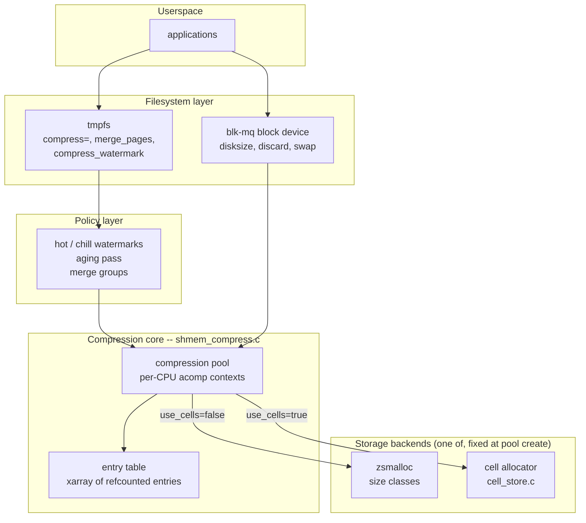
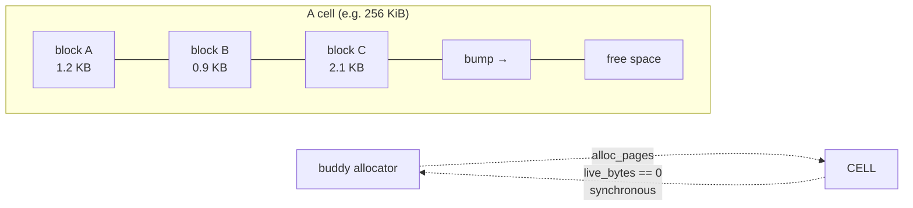
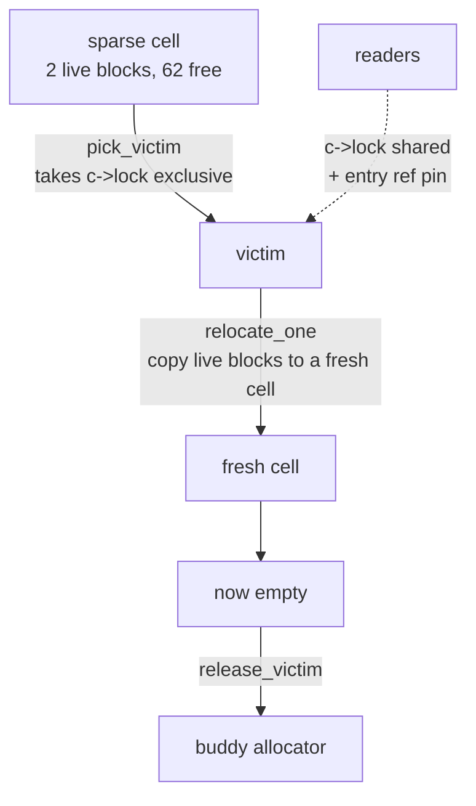
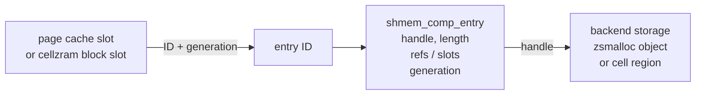
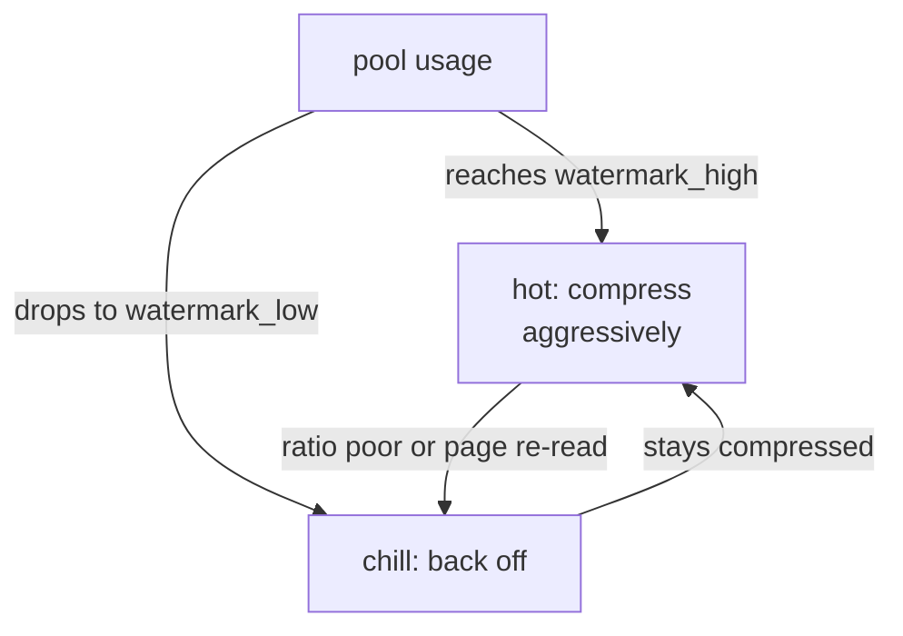
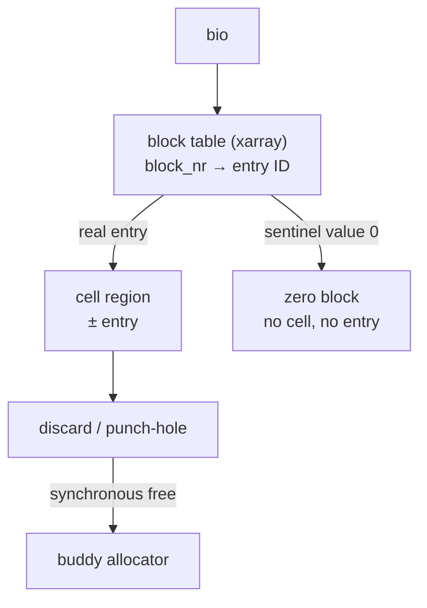
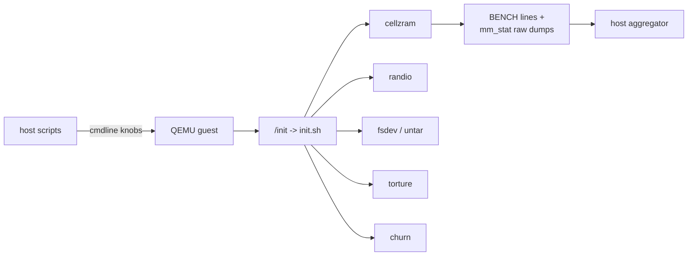

# Transparent tmpfs Compression: What Was Built

A high-level tour of the implementation as it exists today, for readers
who want the shape of the thing before the detail. The forward-looking
design rationale lives in `TMPFS_COMPRESSION_PLAN.md`; the session-by-
session build log lives in `mission_log/`. This document sits between
them: what is in the tree, how the pieces fit, and what has been
measured.

## The one-paragraph version

tmpfs pages can be compressed transparently. A mount with `compress=lz4`
sends reclaim-time pages through a compression pool and stores the
result in one of two interchangeable backends: **zsmalloc** (mature,
size-classed) or **cells** (a bump allocator built for this work). The
cell backend is the novel part: it trades size-class flexibility for
O(1) allocation, zero per-object metadata, and a synchronous return of
freed RAM to the page allocator. The same machinery was then reused to
build **cellzram**, a compressed RAM block device with zram's contract.
Everything is gated by a QEMU test rig with five pass/fail gates and a
benchmark methodology built specifically to survive being written down.

## Layer stack

The compression core does not know or care which backend is active.
Both implement the same three-verb contract -- `store` returns an opaque
handle, `load` copies data out, `free` releases storage -- and callers
dispatch on a single `use_cells` flag. That is what let cellzram reuse
every hot path unchanged.

## The cell allocator

This is the piece the project exists to explore. A **cell** is one
physically contiguous allocation used as a bump-allocated arena.
Compressed blocks are stored at *exact* size: no per-object header, no
size-class rounding, no free list.

The reasoning from the header: the blocks are already small, so every
byte of metadata is a direct tax on the savings compression is supposed
to deliver.

### The six invariants

These are load-bearing; breaking one silently corrupts the model.

| # | invariant | why |
|---|-----------|-----|
| 1 | Only the active cell grows; the bump pointer never retreats | keeps allocation O(1) with no fragmentation analysis |
| 2 | A cell reaching `live_bytes == 0` returns to the buddy **synchronously** | `cell_free()` returns with the pages already available |
| 3 | `cell->base` is direct-map contiguous | no kmap, no bounce buffer, reads span pages by pointer arithmetic |
| 4 | The bump advances under `cp->lock`; the memcpy happens after | lock is never held across a copy or a sleep |
| 5 | A cell carries no pool-wide state | a shadow copy would drift from the authoritative field |
| 6 | One directory slot beyond capacity is reserved for compaction | otherwise evacuating a full directory is a fixed point that frees nothing |

### Compaction

A cell is only reusable as a whole, so holes left by freed blocks are
reclaimed by **evacuating the entire cell**, not by reusing gaps.

Three triggers: the **shrinker** under memory pressure, the `gc_now`
sysfs hook for manual maintenance, and the **store path** when a
cell-backed pool runs out of directory slots (which is how cellzram
avoids write failures it used to hit).

## The entry table

Every stored block gets an ID, not a raw pointer. The ID is what
appears in a page-cache xarray slot or a block device's table.

Three properties worth knowing:

- **Two reference counters.** `slots` counts page-cache slots pointing
  at the entry; `refs` counts slots plus temporary reader pins. The
  split exists so a truncation cannot free storage out from under a
  reader mid-decompress.
- **A generation stamp.** Packed into the xarray value alongside the ID,
  so a stale xarray value can never charge a recycled ID.
- **`merge_pages`.** One entry can span N consecutive pages compressed
  as a single group -- one store, one handle, no per-chunk array.

## Policy: hot, chill, and merge

Compression is not free, so not every page deserves it. Two watermarks
express a hysteresis band:

`compress_watermark=LOW:HIGH` sets the band as percent usage;
`0:0` means eager. Pages whose data does not shrink are simply kept
uncompressed -- the length field of the entry is the raw/compressed
discriminator, so there is no separate metadata to track it.

## cellzram: the same machinery as a block device

cellzram applies zram's contract -- capacity set at runtime via
`disksize`, physical allocation on demand -- on top of the cell backend.

Two design points that are not obvious:

- **Zero blocks are free.** An all-zero write stores a sentinel in the
  table instead of compressing. Filesystem metadata is zero-heavy, so
  this turns ext4's own zero writes into ~free storage.
- **Discard frees synchronously.** When the last reference to a cell
  region drops, the pages go back to the buddy inline. An ext4 delete
  returns RAM *before the syscall returns* -- the property zram's
  architecture cannot offer.

`mm_stat` is derived by **walking the block table on read**, not from
incremental counters. The earlier counter-based version drifted on the
zero-block path (a repeated zero write double-counted `orig_bytes`); the
walk is exact by construction.

## Measurement: the rig

A QEMU guest boots a static initrd and runs self-verifying tests. Five
are pass/fail **gates**; the rest are unit or exploratory tests.

Two methodology rules were learned the hard way and are now enforced:

- **Never quote a single sample.** Cross-boot drift (~3%) is larger than
  many of the effects being resolved, so a benchmark runs N in-boot
  samples and reports high/low/avg/median, then M full boots and reports
  median + IQR across them.
- **Use the control that runs in every boot.** zram runs alongside
  cellzram in the same boot, so the *ratio* between them cancels that
  boot's drift. zram also serves as a canary: a boot whose zram row
  moved is an off boot and gets rejected.

## Measured results

Current state of the `cell_order` axis (the allocation size, 2..10,
default 6 = 256 KiB), measured this session:

**untar workload** (compressible, append-heavy) -- smaller cells win:

| order | cell | RAM held | verify MB/s | rm MB/s |
|------:|------|----------|------------:|--------:|
| 2 | 16 KiB | **16 KiB** | 79.5 | 60.8 |
| 6 | 256 KiB | 256 KiB | 76.1 | 55.5 |
| *zram* | -- | *80 KiB* | *75.5* | *64.4* |

**churn workload** (random overwrite) -- a real tradeoff:

| order | avg MB/s | GC recoveries | RAM held |
|------:|---------:|--------------:|---------:|
| 2 | **133.6** | **0** | 16.6 MiB |
| 6 | 125.3 | 58 | **10.25 MiB** |
| *zram* | *136.3* | -- | *8.0 MiB* |

At order 2 a cell holds only four blocks, so it empties naturally under
random overwrite and returns inline -- the compaction pass never fires,
and cellzram comes within 2% of zram on throughput. But with no GC
there is no compaction either, so fragmentation accumulates and more
RAM is held. Order 6 pays ~9% throughput for GC but keeps RAM closer to
the live set. Neither order dominates.

## Where it stands

**Parked, deliberately.** A logical/physical block split was being
built -- compressing 16 consecutive 4K blocks as one unit, the same
storage layout tmpfs `merge_pages` already produces. Steps landed as
dormant, byte-identical scaffolding (params, unit rekey, validity
bitmap, accessors); the RMW core was not built. The reason: the split's
only measured payoff was a 936-byte entry table on the untar workload,
against ~200 lines of correctness-critical read-modify-write. The real
untar gap was cell *granularity*, which `cell_order` fixes directly.

**The largest open question.** No workload in the rig measures
compression ratio on genuinely compressible, non-zero data. `distinct`
is incompressible; untar is ~2048 zero blocks out of 2061. Every
"cellzram wins here" claim rests on zero-heavy or incompressible
synthetic data. Until a real dataset -- text, binaries, logs -- is
measured against zram, the compression-ratio question is open, and the
split's fate should be decided on that evidence rather than by
momentum.
