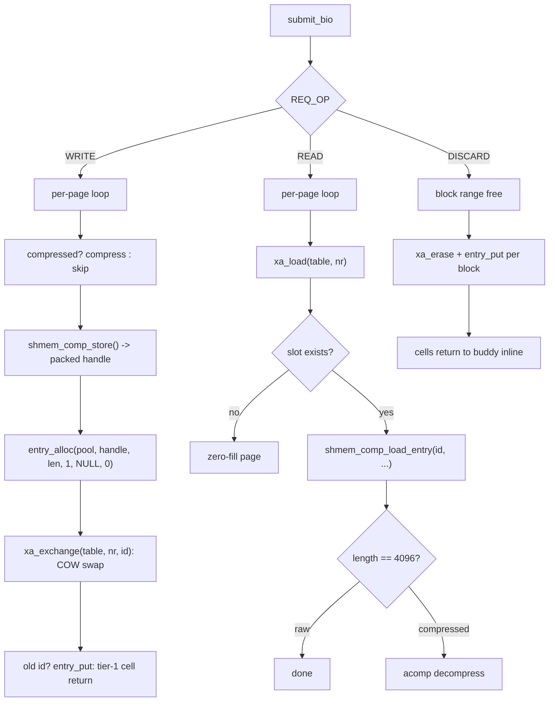

# Plan: Transparent Compression for tmpfs

## Rationale

### Why Transparent Compression for tmpfs?

Memory is the most constrained resource in modern systems. While CPU and storage have seen exponential improvements, RAM capacity grows slowly and is expensive. Many workloads store large amounts of compressible data in tmpfs:

- **Build caches**: Object files, dependency graphs, intermediate build artifacts
- **Package managers**: Downloaded packages, extracted archives
- **Docker/containers**: Image layers, temporary container storage
- **Web servers**: Cached responses, session data, uploaded files
- **Databases**: Temporary tables, query results, write-ahead logs
- **CI/CD systems**: Test artifacts, build outputs, log files
- **Development**: Compiler temporaries, test outputs, debug symbols

In these scenarios, 40-70% of tmpfs data is compressible, but conventional tmpfs stores it uncompressed, wasting valuable RAM.

### The Problem with Current Solutions

**Without compression:**
- tmpfs consumes RAM proportional to file size
- Memory pressure triggers swap (if configured) or OOM
- Users must manually limit tmpfs size or clean up frequently

**With zram (current approach):**
- zram reserves RAM upfront for compressed storage
- Fixed allocation regardless of actual compression ratio
- Adds complexity: separate block device, swap setup, formatting
- Not transparent: requires explicit mount and configuration
- Only works for swapped-out pages, not actively used tmpfs files

**With zswap:**
- Compresses pages during swapout (cold pages only)
- Hot tmpfs data remains uncompressed
- Still requires swap to be configured
- Compression happens too late (after memory pressure)

### Why This Approach is Different

Unlike zram and zswap, this implementation provides **proactive, transparent compression** that:

1. **Compresses actively used tmpfs files** - not just cold/swapped pages
2. **No upfront RAM reservation** - uses zsmalloc pools that grow on demand
3. **Transparent to applications** - no API changes, no code modifications
4. **Integrated into tmpfs** - not a separate block device or swap mechanism
5. **Configurable at runtime** - sysfs interface for tuning
6. **Preserves mmap support** - page-level compression maintains random access

## Comparison: This vs zram

### Architecture Differences

```
┌─────────────────────────────────────────────────────────────┐
│                    zram Approach                            │
├─────────────────────────────────────────────────────────────┤
│                                                             │
│   Application                                               │
│       │                                                     │
│       ▼                                                     │
│   tmpfs (uncompressed)                                      │
│       │                                                     │
│       │  Memory pressure / swap                             │
│       ▼                                                     │
│   Swap device (zram) ──► Block device layer                 │
│                               │                             │
│                               ▼                             │
│                          Compressed RAM pool                │
│                          (reserved upfront)                  │
│                                                             │\�─────────────────────────────────────────────────────────────┘

┌─────────────────────────────────────────────────────────────┐
│              tmpfs Compression Approach                     │
├─────────────────────────────────────────────────────────────┤
│                                                             │
│   Application                                               │
│       │                                                     │
│       ▼                                                     │
│   tmpfs (transparently compressed)                          │
│       │                                                     │
│       ├─► Page cache ──► xarray ──► Compressed entry        │
│       │                              │                      │
│       │                              ▼                      │
│       │                         zsmalloc pool               │
│       │                         (grows on demand)           │
│       │                                                     │
│       └─► mmap() ──► Page fault ──► Decompress on access   │
│                                                             │
└─────────────────────────────────────────────────────────────┘
```

### Detailed Comparison

| Aspect | zram | tmpfs Compression |
|--------|------|-------------------|
| **When compression happens** | During swapout (cold pages) | On write or memory pressure (all pages) |
| **RAM reservation** | Yes - fixed allocation upfront | No - zsmalloc grows on demand |
| **Transparency** | Low - separate device, swap config | High - transparent to applications |
| **mmap support** | Indirect via swap | Native - decompress on page fault |
| **Hot data compression** | No - only cold/swapped pages | Yes - actively used files compressed |
| **Compression ratio tracking** | Limited | Full statistics via sysfs |
| **Configuration complexity** | High - mkswap, swapon, fstab | Low - mount option or sysfs |
| **Overhead** | Block device layer, I/O scheduling | Minimal - direct page cache access |
| **Failure mode** | Swap fails, system slows | Falls back to uncompressed |
| **Use case** | System-wide swap compression | Application-specific tmpfs |

### Memory Efficiency Comparison

**Scenario: 100MB tmpfs with 60% compressible data**

```
┌─────────────────────────────────────────────────────────────┐
│ zram (reserved 100MB for swap):                             │
├─────────────────────────────────────────────────────────────┤
│ Reserved RAM: 100MB (fixed)                                │
│ Actual usage: 40MB uncompressed + 24MB compressed = 64MB   │
│ Wasted reservation: 36MB (36% waste)                       │
│                                                             │
│ Total RAM consumed: 100MB (reserved)                        │
└─────────────────────────────────────────────────────────────┘

┌─────────────────────────────────────────────────────────────┐
│ tmpfs compression (on-demand):                              │
├─────────────────────────────────────────────────────────────┤
│ Reserved RAM: 0MB (no reservation)                         │
│ Actual usage: 40MB uncompressed + 24MB compressed = 64MB   │
│ Wasted reservation: 0MB                                    │
│                                                             │
│ Total RAM consumed: 64MB (actual)                           │
│ Savings vs zram: 36MB (36% less RAM used)                  │
└─────────────────────────────────────────────────────────────┘
```

### Latency Comparison

**Read access to compressed page:**

```
zram path:
  Application read() → Page fault → Swap in from zram → Block I/O → Decompress
  Latency: ~10-50μs (block device overhead)

This approach:
  Application read() → Page fault → Decompress from zsmalloc → Direct access
  Latency: ~2-5μs (no block device overhead)
```

**Write access to compressed page:**

```
zram path:
  Application write() → Write to tmpfs (uncompressed) → Later: swapout → Compress
  Compression happens: After memory pressure (too late)

This approach:
  Application write() → Write to tmpfs → Compress on writeback
  Compression happens: Proactively, during normal operation
```

### When to Use Which

**Use zram when:**
- You need system-wide swap compression
- You're compressing anonymous memory (process heaps)
- You want simple setup (just swap on zram device)
- You don't need hot data compression
- You're okay with fixed RAM reservation

**Use tmpfs compression when:**
- You're compressing tmpfs files specifically
- You want no RAM reservation
- You need hot data compression
- You need mmap support on compressed files
- You want transparent, application-agnostic compression
- You need runtime configuration and statistics

### Hybrid Approach

For maximum benefit, use both:

```bash
# zram for system swap (anonymous memory)
modprobe zram num_devices=1
echo 1G > /sys/block/zram0/disksize
mkswap /dev/zram0
swapon /dev/zram0

# tmpfs compression for file-backed storage
mount -t tmpfs -o compress=lz4,size=4G tmpfs /var/cache
mount -t tmpfs -o compress=lzo tmpfs /tmp/build
```

This gives you:
- zram: Compressed swap for anonymous memory (processes)
- tmpfs compression: Compressed file cache (build artifacts, packages)
- No RAM reservation for either
- Transparent to all applications

## Testing via QEMU with Static Initrd

### Test Environment Overview

QEMU provides an ideal environment for testing kernel features:

- **Isolated**: No impact on host system
- **Reproducible**: Same kernel + initrd = same environment
- **Fast iteration**: Boot in seconds, not minutes
- **Debuggable**: Serial console, gdb support, kernel logs
- **Configurable**: Easy to change kernel config, memory size, etc.

```
┌─────────────────────────────────────────────────────────────┐
│ QEMU Virtual Machine                                        │
├─────────────────────────────────────────────────────────────┤
│  Kernel: bzImage (with CONFIG_TMPFS_COMPRESSION=y)          │
│  Initrd: rootfs.cpio (static test programs)                 │
│  Memory: 512MB-2GB (configurable)                          │
│  Console: Serial (ttyS0) → host terminal                   │
│                                                             │
│  Test programs:                                             │
│  ├── /bin/test_compress      - Basic compression tests      │
│  ├── /bin/test_mmap          - mmap() tests                 │
│  ├── /bin/test_performance   - Benchmarks                   │
│  ├── /bin/test_concurrent    - Multi-threaded tests         │
│  └── /bin/run_all_tests      - Test suite runner            │
└─────────────────────────────────────────────────────────────┘
        │
        ▼ (serial console)
┌─────────────────────────────────────────────────────────────┐
│ Host                                                        │
│  - QEMU process                                             │
│  - Serial output capture                                    │
│  - Optional: 9p filesystem for file transfer               │
└─────────────────────────────────────────────────────────────┘
```

### Phase 1: Build Environment Setup

#### 1.1 Create Test Directory Structure

```bash
#!/bin/bash
# setup_test_env.sh - Create test directory structure

TEST_ROOT="/home/snide/tmpfs-compress-test"
KERNEL_SRC="/home/snide/linux"

mkdir -p ${TEST_ROOT}/{kernel,initrd,tests,results,scripts}
cd ${TEST_ROOT}

echo "Test environment created at ${TEST_ROOT}"
echo "Kernel source: ${KERNEL_SRC}"
```

#### 1.2 Build Kernel with Compression Support

```bash
#!/bin/bash
# build_kernel.sh - Build kernel with tmpfs compression

KERNEL_SRC="/home/snide/linux"
BUILD_DIR="/home/snide/tmpfs-compress-test/kernel"
CROSS_COMPILE=""  # Use native x86_64

cd ${KERNEL_SRC}

# Start with existing config or defconfig
cp .config ${BUILD_DIR}/.config 2>/dev/null || make defconfig

# Enable required options
./scripts/config --file ${BUILD_DIR}/.config \
    --enable CONFIG_TMPFS \
    --enable CONFIG_TMPFS_XATTR \
    --enable CONFIG_TMPFS_QUOTA \
    --enable CONFIG_TMPFS_COMPRESSION \
    --enable CONFIG_TMPFS_COMPRESSOR_DEFAULT \
    --set-str CONFIG_TMPFS_COMPRESSOR_DEFAULT "lz4" \
    --enable CONFIG_CRYPTO \
    --enable CONFIG_CRYPTO_LZ4 \
    --enable CONFIG_CRYPTO_LZO \
    --enable CONFIG_CRYPTO_LZO_RLE \
    --enable CONFIG_CRYPTO_ZSTD \
    --enable CONFIG_ZSMALLOC \
    --enable CONFIG_ZSMALLOC_PIN \
    --enable CONFIG_SWAP \
    --enable CONFIG_ZSWAP \
    --enable CONFIG_SERIAL_8250 \
    --enable CONFIG_SERIAL_8250_CONSOLE \
    --enable CONFIG_SERIAL_8250_NR_UARTS \
    --enable CONFIG_SERIAL_8250_RUNTIME_UARTS \
    --enable CONFIG_DEVTMPFS \
    --enable CONFIG_DEVTMPFS_MOUNT \
    --enable CONFIG_BLK_DEV_INITRD \
    --enable CONFIG_RD_GZIP \
    --enable CONFIG_RD_LZ4 \
    --enable CONFIG_BINFMT_ELF \
    --enable CONFIG_BINFMT_SCRIPT \
    --enable CONFIG_PROC_FS \
    --enable CONFIG_SYSFS \
    --enable CONFIG_TMPFS_POSIX_ACL \
    --enable CONFIG_DEBUG_FS \
    --enable CONFIG_KALLSYMS \
    --enable CONFIG_KALLSYMS_ALL \
    --enable CONFIG_PRINTK \
    --enable CONFIG_SERIAL_8250_CONSOLE

# Build kernel
cd ${KERNEL_SRC}
make -j$(nproc) ARCH=x86_64 LOCALVERSION="-tmpfs-compress"

cp arch/x86/boot/bzImage ${BUILD_DIR}/bzImage
cp .config ${BUILD_DIR}/.config

echo "Kernel built successfully: ${BUILD_DIR}/bzImage"
```

#### 1.3 Build Static Test Programs

```bash
#!/bin/bash
# build_tests.sh - Build static test programs for initrd

TEST_SRC="/home/snide/tmpfs-compress-test/tests"
INITRD_ROOT="/home/snide/tmpfs-compress-test/initrd"

mkdir -p ${INITRD_ROOT}/{bin,dev,proc,sys,tmp,mnt,testdata}

# Compile test programs statically
cd ${TEST_SRC}

for test in test_compress test_mmap test_performance test_concurrent run_all_tests; do
    gcc -static -O2 -o ${INITRD_ROOT}/bin/${test} ${test}.c \
        -lpthread -lm
    echo "Built: ${INITRD_ROOT}/bin/${test}"
done

# Copy busybox for shell and basic utilities
cp /bin/busybox ${INITRD_ROOT}/bin/busybox
for cmd in sh mount umount ls cat echo grep mkdir rm dmesg; do
    ln -sf busybox ${INITRD_ROOT}/bin/${cmd}
done

echo "Test programs built successfully"
```

### Phase 2: Static Initrd Creation

#### 2.1 Minimal Root Filesystem Structure

```
initrd/
├── bin/                    # Static test programs
│   ├── busybox            # Multi-call binary
│   ├── test_compress      # Compression tests
│   ├── test_mmap          # mmap() tests
│   ├── test_performance   # Benchmarks
│   ├── test_concurrent    # Multi-threaded tests
│   └── run_all_tests      # Test suite runner
├── dev/                    # Device nodes
│   ├── console
│   ├── null
│   ├── zero
│   └── ttyS0
├── proc/                   # Proc filesystem mount point
├── sys/                    # Sysfs mount point
├── tmp/                    # Default tmpfs mount point
├── mnt/                    # Test mount points
│   ├── tmpfs_compress
│   ├── tmpfs_no_compress
│   └── tmpfs_lzo
├── testdata/              # Test data files
│   ├── random.bin        # Incompressible data
│   ├── zeros.bin         # Highly compressible
│   ├── text.txt          # Text data
│   └── binary.bin        # Mixed binary
└── init                    # Init script (PID 1)
```

#### 2.2 Init Script

```bash
#!/bin/sh
# init - PID 1 script for test initrd

# Mount essential filesystems
mount -t proc proc /proc
mount -t sysfs sysfs /sys
mount -t devtmpfs devtmpfs /dev 2>/dev/null || {
    mkdir -p /dev
    mknod /dev/console c 5 1
    mknod /dev/null c 1 3
    mknod /dev/zero c 1 5
    mknod /dev/ttyS0 c 4 64
}

# Mount debugfs for kernel debugging
mount -t debugfs debugfs /sys/kernel/debug 2>/dev/null

# Clear dmesg buffer for clean test output
dmesg -c > /dev/null 2>&1

echo "=========================================="
echo "  tmpfs Compression Test Environment"
echo "=========================================="
echo ""

# Display kernel info
echo "Kernel: $(uname -r)"
echo "Memory: $(free -m | grep Mem | awk '{print $2}')MB"
echo ""

# Check if tmpfs compression is available
echo "Checking tmpfs compression support..."
if [ -f /sys/fs/tmpfs/compressor ]; then
    echo "  ✓ Compression sysfs interface found"
    echo "  Current compressor: $(cat /sys/fs/tmpfs/compressor)"
    echo "  Compression enabled: $(cat /sys/fs/tmpfs/compression)"
else
    echo "  ✗ Compression sysfs interface not found"
    echo "  Kernel may not have CONFIG_TMPFS_COMPRESSION=y"
fi
echo ""

# Check for compression modules/features
echo "Kernel compression features:"
grep -E "CONFIG_TMPFS_COMPRESSION|CONFIG_CRYPTO_LZ4|CONFIG_CRYPTO_LZO|CONFIG_ZSMALLOC" /proc/config.gz 2>/dev/null | gunzip | grep -E "=y|=m" || \
    zcat /proc/config.gz 2>/dev/null | grep -E "CONFIG_TMPFS_COMPRESSION|CONFIG_CRYPTO_LZ4|CONFIG_CRYPTO_LZO|CONFIG_ZSMALLOC" | grep -E "=y|=m" || \
    echo "  (config.gz not available)"
echo ""

# Run test suite
echo "Starting test suite..."
echo ""

/bin/run_all_tests
TEST_EXIT=$?

echo ""
echo "=========================================="
echo "  Test suite completed with exit code: ${TEST_EXIT}"
echo "=========================================="

# If TESTS_AUTOMATED=1, shutdown after tests
if [ "${TESTS_AUTOMATED}" = "1" ]; then
    echo ""
    echo "Automated mode: shutting down..."
    sleep 1
    poweroff -f
else
    echo ""
    echo "Dropping to shell for interactive testing..."
    echo "Available commands: test_compress, test_mmap, test_performance"
    echo ""
    exec /bin/sh
fi
```

#### 2.3 Create Initrd Image

```bash
#!/bin/bash
# build_initrd.sh - Create compressed initrd image

INITRD_ROOT="/home/snide/tmpfs-compress-test/initrd"
INITRD_IMAGE="/home/snide/tmpfs-compress-test/rootfs.cpio.gz"

# Create device nodes if not present
mkdir -p ${INITRD_ROOT}/dev
mknod -m 622 ${INITRD_ROOT}/dev/console c 5 1 2>/dev/null
mknod -m 666 ${INITRD_ROOT}/dev/null c 1 3 2>/dev/null
mknod -m 666 ${INITRD_ROOT}/dev/zero c 1 5 2>/dev/null
mknod -m 666 ${INITRD_ROOT}/dev/ttyS0 c 4 64 2>/dev/null
mknod -m 666 ${INITRD_ROOT}/dev/random c 1 8 2>/dev/null
mknod -m 666 ${INITRD_ROOT}/dev/urandom c 1 9 2>/dev/null

# Create test data files
echo "Creating test data..."
dd if=/dev/urandom of=${INITRD_ROOT}/testdata/random.bin bs=1M count=10 2>/dev/null
dd if=/dev/zero of=${INITRD_ROOT}/testdata/zeros.bin bs=1M count=10 2>/dev/null
cat > ${INITRD_ROOT}/testdata/text.txt << 'EOF'
This is a test file with repetitive text content.
This is a test file with repetitive text content.
This is a test file with repetitive text content.
This is a test file with repetitive text content.
This is a test file with repetitive text content.
EOF
dd if=/dev/urandom bs=1K count=100 2>/dev/null | cat - ${INITRD_ROOT}/testdata/text.txt > ${INITRD_ROOT}/testdata/binary.bin

# Create initrd image
cd ${INITRD_ROOT}
find . | cpio -o -H newc 2>/dev/null | gzip -9 > ${INITRD_IMAGE}

echo "Initrd created: ${INITRD_IMAGE}"
echo "Size: $(du -h ${INITRD_IMAGE} | cut -f1)"
```

### Phase 3: Test Programs

#### 3.1 Basic Compression Test

```c
// test_compress.c - Basic compression tests
#include <stdio.h>
#include <stdlib.h>
#include <string.h>
#include <fcntl.h>
#include <unistd.h>
#include <sys/stat.h>
#include <sys/mman.h>
#include <sys/ioctl.h>
#include <errno.h>
#include <time.h>

#define TEST_DIR "/mnt/tmpfs_compress"
#define TEST_FILE TEST_DIR "/test_file.dat"
#define TEST_SIZE (10 * 1024 * 1024)  // 10MB

static int tests_passed = 0;
static int tests_failed = 0;

#define ASSERT(cond, msg) do { \
    if (cond) { \
        printf("  ✓ %s\n", msg); \
        tests_passed++; \
    } else { \
        printf("  ✗ %s (failed)\n", msg); \
        tests_failed++; \
    } \
} while(0)

void create_test_file(const char *path, int type, size_t size) {
    int fd = open(path, O_WRONLY | O_CREAT | O_TRUNC, 0644);
    if (fd < 0) {
        perror("open");
        exit(1);
    }
    
    char *buf = malloc(4096);
    size_t written = 0;
    
    while (written < size) {
        size_t to_write = size - written;
        if (to_write > 4096) to_write = 4096;
        
        switch (type) {
            case 0:  // Zeros (highly compressible)
                memset(buf, 0, to_write);
                break;
            case 1:  // Random (incompressible)
                for (size_t i = 0; i < to_write; i++)
                    buf[i] = rand() & 0xFF;
                break;
            case 2:  // Text (compressible)
                for (size_t i = 0; i < to_write; i++)
                    buf[i] = 'A' + (rand() % 26);
                break;
            case 3:  // Repetitive pattern (very compressible)
                for (size_t i = 0; i < to_write; i++)
                    buf[i] = (i / 100) & 0xFF;
                break;
        }
        
        if (write(fd, buf, to_write) != (ssize_t)to_write) {
            perror("write");
            close(fd);
            exit(1);
        }
        written += to_write;
    }
    
    close(fd);
    free(buf);
}

long get_file_size(const char *path) {
    struct stat st;
    if (stat(path, &st) < 0) return -1;
    return st.st_size;
}

long get_compressed_pages(void) {
    FILE *f = fopen("/sys/fs/tmpfs/comp_stats", "r");
    if (!f) return -1;
    
    char line[256];
    long pages = -1;
    while (fgets(line, sizeof(line), f)) {
        if (sscanf(line, "compressed_pages: %ld", &pages) == 1)
            break;
    }
    fclose(f);
    return pages;
}

void test_basic_compression(void) {
    printf("\n[TEST] Basic compression functionality\n");
    printf("----------------------------------------\n");
    
    // Mount tmpfs with compression
    mkdir(TEST_DIR, 0755);
    int ret = mount("tmpfs", TEST_DIR, "tmpfs", 0, "compress");
    ASSERT(ret == 0, "Mount tmpfs with compression");
    if (ret < 0) return;
    
    // Check compression is enabled
    FILE *f = fopen("/sys/fs/tmpfs/compression", "r");
    if (f) {
        int enabled = 0;
        fscanf(f, "%d", &enabled);
        fclose(f);
        ASSERT(enabled == 1, "Compression is enabled");
    }
    
    // Test 1: Write compressible data
    printf("\n  Writing compressible data (zeros)...\n");
    create_test_file(TEST_FILE, 0, TEST_SIZE);
    ASSERT(get_file_size(TEST_FILE) == TEST_SIZE, "File size correct");
    
    long pages_before = get_compressed_pages();
    printf("  Compressed pages before read: %ld\n", pages_before);
    
    // Read file to trigger decompression
    int fd = open(TEST_FILE, O_RDONLY);
    ASSERT(fd >= 0, "Open file for reading");
    if (fd >= 0) {
        char buf[4096];
        size_t total = 0;
        ssize_t n;
        while ((n = read(fd, buf, sizeof(buf))) > 0)
            total += n;
        close(fd);
        ASSERT(total == TEST_SIZE, "Read all data back");
        
        long pages_after = get_compressed_pages();
        printf("  Compressed pages after read: %ld\n", pages_after);
    }
    
    // Test 2: Write incompressible data
    printf("\n  Writing incompressible data (random)...\n");
    create_test_file(TEST_FILE, 1, TEST_SIZE);
    ASSERT(get_file_size(TEST_FILE) == TEST_SIZE, "File size correct (random)");
    
    // Test 3: Write compressible text
    printf("\n  Writing compressible text...\n");
    create_test_file(TEST_FILE, 2, TEST_SIZE);
    ASSERT(get_file_size(TEST_FILE) == TEST_SIZE, "File size correct (text)");
    
    umount(TEST_DIR);
}

void test_mmap_compressed(void) {
    printf("\n[TEST] mmap() with compressed files\n");
    printf("------------------------------------\n");
    
    mkdir(TEST_DIR, 0755);
    mount("tmpfs", TEST_DIR, "tmpfs", 0, "compress");
    
    // Create compressible file
    create_test_file(TEST_FILE, 3, TEST_SIZE);
    
    // mmap the file
    int fd = open(TEST_FILE, O_RDONLY);
    ASSERT(fd >= 0, "Open file for mmap");
    if (fd >= 0) {
        void *mapped = mmap(NULL, TEST_SIZE, PROT_READ, MAP_PRIVATE, fd, 0);
        ASSERT(mapped != MAP_FAILED, "mmap() succeeds");
        
        if (mapped != MAP_FAILED) {
            // Access memory to trigger decompression
            volatile char *p = mapped;
            char sum = 0;
            for (size_t i = 0; i < TEST_SIZE; i += 4096)
                sum += p[i];
            
            ASSERT(1, "mmap access triggers decompression");
            printf("  Accessed %zu pages, checksum: %d\n", 
                   TEST_SIZE / 4096, sum);
            
            munmap(mapped, TEST_SIZE);
        }
        close(fd);
    }
    
    umount(TEST_DIR);
}

void test_compression_ratio(void) {
    printf("\n[TEST] Compression ratio measurement\n");
    printf("-------------------------------------\n");
    
    mkdir(TEST_DIR, 0755);
    mount("tmpfs", TEST_DIR, "tmpfs", 0, "compress");
    
    // Test different data types
    const char *data_types[] = {"zeros", "random", "text", "pattern"};
    
    for (int i = 0; i < 4; i++) {
        printf("\n  Data type: %s\n", data_types[i]);
        create_test_file(TEST_FILE, i, TEST_SIZE);
        
        long size = get_file_size(TEST_FILE);
        printf("  File size: %ld bytes\n", size);
        
        // Trigger compression by reading and writing
        int fd = open(TEST_FILE, O_RDWR);
        if (fd >= 0) {
            char buf[4096];
            lseek(fd, 0, SEEK_SET);
            read(fd, buf, sizeof(buf));
            lseek(fd, 0, SEEK_SET);
            write(fd, buf, sizeof(buf));
            close(fd);
        }
        
        // Check stats
        FILE *f = fopen("/sys/fs/tmpfs/comp_stats", "r");
        if (f) {
            char line[256];
            long comp_pages = 0, uncomp_pages = 0;
            long comp_bytes = 0, uncomp_bytes = 0;
            
            while (fgets(line, sizeof(line), f)) {
                sscanf(line, "compressed_pages: %ld", &comp_pages);
                sscanf(line, "uncompressed_pages: %ld", &uncomp_pages);
                sscanf(line, "total_compressed_bytes: %ld", &comp_bytes);
                sscanf(line, "total_uncompressed_bytes: %ld", &uncomp_bytes);
            }
            fclose(f);
            
            if (uncomp_bytes > 0) {
                double ratio = (double)comp_bytes / uncomp_bytes * 100;
                printf("  Compression ratio: %.2f%%\n", ratio);
                printf("  Compressed: %ld bytes, Original: %ld bytes\n",
                       comp_bytes, uncomp_bytes);
            }
        }
    }
    
    umount(TEST_DIR);
}

int main(int argc, char *argv[]) {
    printf("tmpfs Compression Test Suite\n");
    printf("============================\n");
    
    srand(time(NULL));
    
    test_basic_compression();
    test_mmap_compressed();
    test_compression_ratio();
    
    printf("\n============================\n");
    printf("Results: %d passed, %d failed\n", tests_passed, tests_failed);
    printf("============================\n");
    
    return tests_failed > 0 ? 1 : 0;
}
```

#### 3.2 Performance Benchmark Test

```c
// test_performance.c - Performance benchmarks
#include <stdio.h>
#include <stdlib.h>
#include <string.h>
#include <fcntl.h>
#include <unistd.h>
#include <sys/stat.h>
#include <sys/mman.h>
#include <sys/time.h>
#include <time.h>

#define TEST_DIR "/mnt/perf_test"
#define ITERATIONS 100

static double get_time_ms(void) {
    struct timeval tv;
    gettimeofday(&tv, NULL);
    return tv.tv_sec * 1000.0 + tv.tv_usec / 1000.0;
}

void benchmark_write(int size, const char *data_type, int compress) {
    char path[256];
    snprintf(path, sizeof(path), "%s/test_%d_%s.dat", 
             TEST_DIR, size, compress ? "comp" : "nocomp");
    
    char *buf = malloc(size);
    
    // Fill buffer based on type
    if (strcmp(data_type, "zeros") == 0)
        memset(buf, 0, size);
    else if (strcmp(data_type, "random") == 0) {
        for (int i = 0; i < size; i++)
            buf[i] = rand() & 0xFF;
    } else {
        for (int i = 0; i < size; i++)
            buf[i] = 'A' + (rand() % 26);
    }
    
    double start = get_time_ms();
    
    for (int i = 0; i < ITERATIONS; i++) {
        int fd = open(path, O_WRONLY | O_CREAT | O_TRUNC, 0644);
        if (fd >= 0) {
            write(fd, buf, size);
            close(fd);
        }
        unlink(path);
    }
    
    double end = get_time_ms();
    double avg_ms = (end - start) / ITERATIONS;
    
    printf("  Write %dKB %s (%s): %.2f ms avg\n", 
           size / 1024, data_type, compress ? "compressed" : "plain",
           avg_ms);
    
    free(buf);
}

void benchmark_read(int size, const char *data_type, int compress) {
    char path[256];
    snprintf(path, sizeof(path), "%s/test_read_%d_%s.dat",
             TEST_DIR, size, compress ? "comp" : "nocomp");
    
    // Create test file
    int fd = open(path, O_WRONLY | O_CREAT | O_TRUNC, 0644);
    char *buf = malloc(size);
    if (strcmp(data_type, "zeros") == 0)
        memset(buf, 0, size);
    else if (strcmp(data_type, "random") == 0) {
        for (int i = 0; i < size; i++)
            buf[i] = rand() & 0xFF;
    } else {
        for (int i = 0; i < size; i++)
            buf[i] = 'A' + (rand() % 26);
    }
    write(fd, buf, size);
    close(fd);
    
    // Benchmark read
    double start = get_time_ms();
    
    for (int i = 0; i < ITERATIONS; i++) {
        fd = open(path, O_RDONLY);
        if (fd >= 0) {
            read(fd, buf, size);
            close(fd);
        }
    }
    
    double end = get_time_ms();
    double avg_ms = (end - start) / ITERATIONS;
    
    printf("  Read  %dKB %s (%s): %.2f ms avg\n",
           size / 1024, data_type, compress ? "compressed" : "plain",
           avg_ms);
    
    unlink(path);
    free(buf);
}

void benchmark_mmap(int size, const char *data_type, int compress) {
    char path[256];
    snprintf(path, sizeof(path), "%s/test_mmap_%d_%s.dat",
             TEST_DIR, size, compress ? "comp" : "nocomp");
    
    // Create test file
    int fd = open(path, O_WRONLY | O_CREAT | O_TRUNC, 0644);
    char *buf = malloc(size);
    if (strcmp(data_type, "zeros") == 0)
        memset(buf, 0, size);
    else if (strcmp(data_type, "random") == 0) {
        for (int i = 0; i < size; i++)
            buf[i] = rand() & 0xFF;
    } else {
        for (int i = 0; i < size; i++)
            buf[i] = 'A' + (rand() % 26);
    }
    write(fd, buf, size);
    close(fd);
    
    // Benchmark mmap
    double start = get_time_ms();
    
    for (int i = 0; i < ITERATIONS; i++) {
        fd = open(path, O_RDONLY);
        if (fd >= 0) {
            void *mapped = mmap(NULL, size, PROT_READ, MAP_PRIVATE, fd, 0);
            if (mapped != MAP_FAILED) {
                // Touch every page
                volatile char *p = mapped;
                char sum = 0;
                for (int j = 0; j < size; j += 4096)
                    sum += p[j];
                munmap(mapped, size);
            }
            close(fd);
        }
    }
    
    double end = get_time_ms();
    double avg_ms = (end - start) / ITERATIONS;
    
    printf("  mmap  %dKB %s (%s): %.2f ms avg\n",
           size / 1024, data_type, compress ? "compressed" : "plain",
           avg_ms);
    
    unlink(path);
    free(buf);
}

int main(void) {
    printf("tmpfs Compression Performance Benchmarks\n");
    printf("==========================================\n");
    
    // Mount tmpfs for testing
    mkdir(TEST_DIR, 0755);
    
    int sizes[] = {4096, 16384, 65536, 262144, 1048576};
    const char *types[] = {"zeros", "random", "text"};
    
    printf("\n--- Write Benchmarks ---\n");
    for (int s = 0; s < 5; s++) {
        for (int t = 0; t < 3; t++) {
            mount("tmpfs", TEST_DIR, "tmpfs", 0, "compress");
            benchmark_write(sizes[s], types[t], 1);
            umount(TEST_DIR);
            
            mount("tmpfs", TEST_DIR, "tmpfs", 0, "");
            benchmark_write(sizes[s], types[t], 0);
            umount(TEST_DIR);
        }
    }
    
    printf("\n--- Read Benchmarks ---\n");
    for (int s = 0; s < 5; s++) {
        for (int t = 0; t < 3; t++) {
            mount("tmpfs", TEST_DIR, "tmpfs", 0, "compress");
            benchmark_read(sizes[s], types[t], 1);
            umount(TEST_DIR);
            
            mount("tmpfs", TEST_DIR, "tmpfs", 0, "");
            benchmark_read(sizes[s], types[t], 0);
            umount(TEST_DIR);
        }
    }
    
    printf("\n--- mmap Benchmarks ---\n");
    for (int s = 0; s < 5; s++) {
        for (int t = 0; t < 3; t++) {
            mount("tmpfs", TEST_DIR, "tmpfs", 0, "compress");
            benchmark_mmap(sizes[s], types[t], 1);
            umount(TEST_DIR);
            
            mount("tmpfs", TEST_DIR, "tmpfs", 0, "");
            benchmark_mmap(sizes[s], types[t], 0);
            umount(TEST_DIR);
        }
    }
    
    return 0;
}
```

### Phase 4: QEMU Launch Scripts

#### 4.1 Basic QEMU Launcher

```bash
#!/bin/bash
# run_qemu.sh - Launch QEMU with test initrd

QEMU="/usr/bin/qemu-system-x86_64"
KERNEL="/home/snide/tmpfs-compress-test/kernel/bzImage"
INITRD="/home/snide/tmpfs-compress-test/rootfs.cpio.gz"
RESULTS="/home/snide/tmpfs-compress-test/results"
MEMORY="1G"
CPUS="2"
SERIAL_LOG="${RESULTS}/serial_$(date +%Y%m%d_%H%M%S).log"

mkdir -p ${RESULTS}

echo "Starting QEMU test environment..."
echo "  Kernel: ${KERNEL}"
echo "  Initrd: ${INITRD}"
echo "  Memory: ${MEMORY}"
echo "  CPUs: ${CPUS}"
echo "  Serial log: ${SERIAL_LOG}"
echo ""

# Run QEMU
${QEMU} \
    -kernel ${KERNEL} \
    -initrd ${INITRD} \
    -m ${MEMORY} \
    -smp ${CPUS} \
    -nographic \
    -append "console=ttyS0 earlyprintk=serial,ttyS0,115200 ignore_loglevel" \
    -serial file:${SERIAL_LOG} \
    -display none \
    -no-reboot \
    -monitor none \
    -append "rdinit=/init"

EXIT_CODE=$?

echo ""
echo "QEMU exited with code: ${EXIT_CODE}"
echo "Serial log saved to: ${SERIAL_LOG}"

# Parse results from log
echo ""
echo "Extracting test results..."
grep -E "Results:.*passed.*failed|✓|✗" ${SERIAL_LOG} | tail -20
```

#### 4.2 Automated Test Runner

```bash
#!/bin/bash
# run_tests.sh - Automated test suite runner

RESULTS="/home/snide/tmpfs-compress-test/results"
TIMESTAMP=$(date +%Y%m%d_%H%M%S)
TEST_RESULTS="${RESULTS}/test_results_${TIMESTAMP}.txt"

mkdir -p ${RESULTS}

echo "========================================" | tee ${TEST_RESULTS}
echo "tmpfs Compression Automated Test Suite" | tee -a ${TEST_RESULTS}
echo "Timestamp: ${TIMESTAMP}" | tee -a ${TEST_RESULTS}
echo "========================================" | tee -a ${TEST_RESULTS}
echo "" | tee -a ${TEST_RESULTS}

# Test 1: Basic functionality
echo "[TEST 1] Basic Compression Functionality" | tee -a ${TEST_RESULTS}
./run_qemu.sh 2>&1 | tee -a ${TEST_RESULTS}
echo "" | tee -a ${TEST_RESULTS}

# Extract summary
echo "[SUMMARY]" | tee -a ${TEST_RESULTS}
grep "Results:.*passed.*failed" ${RESULTS}/serial_*.log | tail -1 | tee -a ${TEST_RESULTS}
echo "" | tee -a ${TEST_RESULTS}

echo "Full serial logs available in: ${RESULTS}/" | tee -a ${TEST_RESULTS}
echo "Test results saved to: ${TEST_RESULTS}" | tee -a ${TEST_RESULTS}
```

#### 4.3 Interactive Debugging Session

```bash
#!/bin/bash
# debug_session.sh - Interactive QEMU session for debugging

QEMU="/usr/bin/qemu-system-x86_64"
KERNEL="/home/snide/tmpfs-compress-test/kernel/bzImage"
INITRD="/home/snide/tmpfs-compress-test/rootfs.cpio.gz"
MEMORY="2G"

# Check if kernel has debug symbols
if [ -f "${KERNEL}.debug" ]; then
    echo "Kernel debug symbols found"
    echo "GDB remote debugging: gdb -ex 'target remote :1234'"
    GDB_PORT="-s -S"
else
    echo "No debug symbols (run 'make debuginfo' for GDB support)"
    GDB_PORT=""
fi

echo ""
echo "Starting interactive QEMU session..."
echo "Commands will be available in the guest shell"
echo "Press Ctrl-A X to exit QEMU"
echo ""

${QEMU} \
    -kernel ${KERNEL} \
    -initrd ${INITRD} \
    -m ${MEMORY} \
    -smp 2 \
    -nographic \
    -append "console=ttyS0 ignore_loglevel" \
    -serial stdio \
    -display none \
    ${GDB_PORT}
```

### Phase 5: Test Data Generation

```bash
#!/bin/bash
# generate_test_data.sh - Create various test data files

TEST_DATA="/home/snide/tmpfs-compress-test/initrd/testdata"
mkdir -p ${TEST_DATA}

# Zeros (highly compressible)
dd if=/dev/zero of=${TEST_DATA}/zeros_10MB.bin bs=1M count=10 2>/dev/null

# Random (incompressible)
dd if=/dev/urandom of=${TEST_DATA}/random_10MB.bin bs=1M count=10 2>/dev/null

# Text (compressible)
for i in $(seq 1 100000); do
    echo "Line $i: The quick brown fox jumps over the lazy dog."
done > ${TEST_DATA}/text_10MB.txt

# Repetitive pattern (very compressible)
python3 -c "
import struct
data = b'\x00\x01\x02\x03' * (2.5 * 1024 * 1024)
open('${TEST_DATA}/pattern_10MB.bin', 'wb').write(data)
" 2>/dev/null || \
    dd if=/dev/zero bs=1M count=10 2>/dev/null | \
    tr '\0' '\x01\x02\x03\x04' > ${TEST_DATA}/pattern_10MB.bin

# Binary with structure (moderately compressible)
for i in $(seq 1 50000); do
    printf "HEADER:%08x DATA:%s\n" $i "$(head -c 100 /dev/urandom | xxd -p)"
done > ${TEST_DATA}/binary_10MB.dat

# Sparse file (mostly zeros with occasional data)
python3 -c "
import os
with open('${TEST_DATA}/sparse_10MB.bin', 'wb') as f:
    for i in range(100):
        f.seek(i * 100000)
        f.write(os.urandom(1000))
" 2>/dev/null || \
    echo "Python3 not available, skipping sparse file"

echo "Test data files created:"
ls -lh ${TEST_DATA}/
```

### Phase 6: Debugging and Troubleshooting

#### 6.1 Kernel Debug Output

Add debug prints to compression code:

```c
// In mm/shmem_compress.c

#ifdef CONFIG_TMPFS_COMPRESSION_DEBUG
#define comp_dbg(fmt, ...) \
    pr_debug("shmem_comp: " fmt "\n", ##__VA_ARGS__)
#else
#define comp_dbg(fmt, ...) \
    pr_debug("shmem_comp: " fmt "\n", ##__VA_ARGS__)
#endif

// Usage:
comp_dbg("compressing page %lu: src=%p dst=%p", index, src, dst);
comp_dbg("compressed %u -> %u bytes", src_len, *dst_len);
comp_dbg("decompressing handle=%lu len=%u", handle, len);
```

Enable debug in kernel command line:
```
console=ttyS0 ignore_loglevel dyndbg="file mm/shmem_compress.c +p"
```

#### 6.2 Sysfs Debug Interface

```c
// Add to mm/shmem.c

static ssize_t comp_debug_show(struct kobject *kobj,
                                struct kobj_attribute *attr, char *buf)
{
    struct shmem_comp_debug_info info;
    
    shmem_comp_get_debug_info(&info);
    
    return sysfs_emit(buf,
        "pools: %d\n"
        "active_pools: %d\n"
        "total_allocated_bytes: %lu\n"
        "total_compressed_pages: %lu\n"
        "pending_compressions: %lu\n"
        "worker_threads: %d\n"
        "last_error: %d (%s)\n",
        info.nr_pools,
        info.active_pools,
        info.total_allocated,
        info.compressed_pages,
        info.pending,
        info.workers,
        info.last_error,
        info.last_error_str);
}
TMPFS_ATTR_RO(comp_debug);
```

#### 6.3 Performance Tracing

```c
// Add tracepoints for performance analysis

TRACE_EVENT(shmem_comp_compress,
    TP_PROTO(unsigned long ino, pgoff_t index, \
             unsigned int src_len, unsigned int dst_len, \
             int ret, u64 duration_ns),
    
    TP_ARGS(ino, index, src_len, dst_len, ret, duration_ns),
    
    TP_STRUCT__entry(
        __field(unsigned long, ino)
        __field(pgoff_t, index)
        __field(unsigned int, src_len)
        __field(unsigned int, dst_len)
        __field(int, ret)
        __field(u64, duration_ns)
    ),
    
    TP_fast_assign(
        __entry->ino = ino;
        __entry->index = index;
        __entry->src_len = src_len;
        __entry->dst_len = dst_len;
        __entry->ret = ret;
        __entry->duration_ns = duration_ns;
    ),
    
    TP_printk("ino=%lu index=%lu %u->%u ret=%d time=%llums",
              __entry->ino, __entry->index,
              __entry->src_len, __entry->dst_len,
              __entry->ret, __entry->duration_ns / 1000000)
);
```

Use with trace-cmd or ftrace:
```bash
# In guest shell
echo 1 > /sys/kernel/debug/tracing/events/shmem/enable
cat /sys/kernel/debug/tracing/trace_pipe
```

### Phase 7: Continuous Integration

#### 7.1 CI Pipeline Script

```yaml
# .github/workflows/tmpfs-compression.yml
name: tmpfs-compression-tests

on:
  push:
    branches: [ main, develop ]
  pull_request:
    branches: [ main ]

jobs:
  build-and-test:
    runs-on: ubuntu-latest
    
    steps:
    - uses: actions/checkout@v2
    
    - name: Setup build environment
      run: |
        sudo apt-get update
        sudo apt-get install -y \
          build-essential libncurses-dev bison flex \
          libssl-dev libelf-dev qemu-system-x86
    
    - name: Build kernel
      run: |
        ./scripts/build_kernel.sh
    
    - name: Build test programs
      run: |
        ./scripts/build_tests.sh
    
    - name: Create initrd
      run: |
        ./scripts/build_initrd.sh
    
    - name: Run tests
      run: |
        ./scripts/run_tests.sh
    
    - name: Upload results
      if: always()
      uses: actions/upload-artifact@v2
      with:
        name: test-results
        path: results/
```

#### 7.2 Performance Regression Detection

```bash
#!/bin/bash
# check_performance.sh - Detect performance regressions

BASELINE="/home/snide/tmpfs-compress-test/results/baseline.txt"
CURRENT="/home/snide/tmpfs-compress-test/results/current.txt"
THRESHOLD=20  # 20% tolerance

if [ ! -f "${BASELINE}" ]; then
    echo "No baseline found, creating one..."
    cp ${CURRENT} ${BASELINE}
    exit 0
fi

echo "Comparing performance..."
echo "Baseline: ${BASELINE}"
echo "Current:  ${CURRENT}"
echo ""

REGRESSIONS=0

while IFS= read -r line; do
    # Parse benchmark results
    if [[ "${line}" =~ Write.*ms.*avg ]]; then
        baseline_time=$(grep -oP '\d+\.\d+' <<< "${line}" | head -1)
        current_line=$(grep -F "${line%%:*}" ${CURRENT} | head -1)
        current_time=$(grep -oP '\d+\.\d+' <<< "${current_line}" | head -1)
        
        if [ -n "${baseline_time}" ] && [ -n "${current_time}" ]; then
            diff=$(echo "${current_time} ${baseline_time}" | awk '{print ($1/$2 - 1) * 100}')
            if (( $(echo "${diff} > ${THRESHOLD}" | bc -l) )); then
                echo "REGRESSION: ${line}"
                echo "  Baseline: ${baseline_time}ms, Current: ${current_time}ms"
                echo "  Regression: ${diff}%"
                REGRESSIONS=$((REGRESSIONS + 1))
            fi
        fi
    fi
done < "${CURRENT}"

if [ ${REGRESSIONS} -gt 0 ]; then
    echo ""
    echo "Found ${REGRESSIONS} performance regressions"
    exit 1
else
    echo "No performance regressions detected"
    exit 0
fi
```

## Implementation Plan

## Overview

Add transparent page-level compression to tmpfs, allowing files to be compressed in-memory without reserving RAM. Uses LZ4/LZO via kernel crypto API, stored in zsmalloc pools.

## Goals

1. Transparent compression for tmpfs files
2. No RAM reservation (unlike zram)
3. Page-level compression (4KB granularity)
4. mmap support (decompress on page fault)
5. Compatible with existing shmem infrastructure
6. Runtime configuration via sysfs
7. Per-mount and per-file control

## Non-Goals

- Whole-file compression (breaks mmap)
- Compression of kernel-internal shmem (only tmpfs files)
- Swap integration (separate feature)

## Architecture

```
┌─────────────────────────────────────────────────────────────┐
│                      Userspace                              │
├─────────────────────────────────────────────────────────────┤
│  read() / write() / mmap() / fallocate()                    │
└─────────────────────────────────────────────────────────────┘
                            │
                            ▼
┌─────────────────────────────────────────────────────────────┐
│                    VFS / Page Cache                         │
│  filemap_get_entry() → xarray lookup                        │
│  ┌─────────────────────────────────────────────────────┐   │
│  │  Entry Type:                                          │   │
│  │  - Folio pointer (normal uncompressed page)          │   │
│  │  - Swap entry (xa_mk_value) → existing swap          │   │
│  │  - Compressed entry (xa_mk_value) → NEW              │   │
│  └─────────────────────────────────────────────────────┘   │
└─────────────────────────────────────────────────────────────┘
                            │
              ┌─────────────┴─────────────┐
              ▼                           ▼
┌───────────────────────┐     ┌───────────────────────┐
│    Write Path         │     │     Read Path         │
│                       │     │                       │
│ shmem_write_end()     │     │ shmem_get_folio()     │
│   ↓                   │     │   ↓                   │
│ [Optional compress]   │     │ xa_is_shmem_comp()?   │
│   ↓                   │     │   ↓ Yes               │
│ shmem_compress_folio()│     │ shmem_decompress()    │
│   ↓                   │     │   ↓                   │
│ zs_malloc()           │     │ zs_obj_read()         │
│   ↓                   │     │   ↓                   │
│ Replace xarray entry  │     │ crypto_acomp_decompress│
└───────────────────────┘     └───────────────────────┘
              │                           │
              └─────────────┬─────────────┘
                            ▼
┌─────────────────────────────────────────────────────────────┐
│                   Compression Pool                          │
│                                                             │
│  struct shmem_comp_pool {                                   │
│      struct crypto_acomp *acomp;    // LZ4/LZO instance     │
│      struct zs_pool *storage;       // zsmalloc pool        │
│      struct percpu_struct *pcpu;    // Per-CPU contexts     │
│  };                                                         │
│                                                             │
│  Per-CPU context (16KB for LZ4):                            │
│  struct shmem_comp_pcpu {                                   │
│      struct crypto_acomp *acomp;                            │
│      struct acomp_req *req;                                 │
│      struct mutex lock;                                     │
│      char *buffer;              // PAGE_SIZE output         │
│  };                                                         │
└─────────────────────────────────────────────────────────────┘
```

## Implementation Phases

### Phase 1: Infrastructure (Foundation)

**Files to create:**
- `mm/shmem_compress.c` - Compression pool management
- `include/linux/shmem_compress.h` - Internal structures

**Files to modify:**
- `include/linux/shmem_fs.h` - Add compression fields to shmem_sb_info
- `mm/Kconfig` - Add CONFIG_TMPFS_COMPRESSION
- `mm/Makefile` - Add shmem_compress.o

**Tasks:**
1. [ ] Define `struct shmem_comp_pool` and per-CPU context
2. [ ] Implement pool create/destroy functions
3. [ ] Implement compression/decompression using crypto_acomp
4. [ ] Add zsmalloc integration for storage
5. [ ] Define compressed entry encoding for xarray

### Phase 2: Page Cache Integration

**Files to modify:**
- `mm/shmem.c` - Main integration point
- `include/linux/swapops.h` - Add compressed entry type helpers

**Tasks:**
1. [ ] Add `xa_is_shmem_comp()` helper
2. [ ] Add `shmem_comp_to_radix_entry()` encoding
3. [ ] Add `shmem_radix_to_comp_entry()` decoding
4. [ ] Modify `shmem_get_folio_gfp()` to handle compressed entries
5. [ ] Implement `shmem_decompress_folio()` for read path
6. [ ] Modify `shmem_write_end()` to optionally compress
7. [ ] Implement `shmem_compress_folio()` for write path

### Phase 3: Sysfs and Mount Options

**Files to modify:**
- `mm/shmem.c` - Sysfs attributes and mount option parsing

**Tasks:**
1. [ ] Add global config variables (enabled, compressor, threshold)
2. [ ] Add sysfs attributes under `/sys/fs/tmpfs/`
3. [ ] Add mount options: `compress`, `nocompress`, `compress=lz4`, `compress_threshold=N`
4. [ ] Implement mount-time pool initialization
5. [ ] Add statistics tracking and reporting

### Phase 4: Advanced Features

**Tasks:**
1. [ ] Add per-file compression flag (FS_COMPR_FL)
2. [ ] Implement ioctl for per-file control
3. [ ] Add shrinker for memory pressure compression
4. [ ] Handle THP interaction (split before compress)
5. [ ] Add swap interaction (compress before swapout)
6. [ ] Implement deferred compression worker

### Phase 5: Testing and Optimization

**Tasks:**
1. [ ] Write unit tests for compression/decompression
2. [ ] Write integration tests for read/write/mmap paths
3. [ ] Benchmark compression ratio and latency
4. [ ] Optimize hot paths
5. [ ] Add debug statistics
6. [ ] Write documentation

## Detailed Design

### Compressed Entry Encoding

```c
// include/linux/shmem_compress.h

/*
 * Compressed entry stored in xarray as xa_value
 *
 * Bit layout (64-bit):
 * ┌─────────────────────────────────────────────────────────┐
 * │ 63      40 │ 39                  12 │ 11       0      │
 * │   unused   │     zs_handle (28)    │  length (12)     │
 * └─────────────────────────────────────────────────────────┘
 *
 * - zs_handle: zsmalloc handle (max 256MB pool = 28 bits)
 * - length: compressed size in bytes (max 4095, fits 12 bits)
 */

struct shmem_comp_entry {
    unsigned long handle;    // zsmalloc handle
    unsigned int length;     // Compressed size (bytes)
    bool referenced;         // For LRU eviction
};

static inline void *shmem_comp_to_radix_entry(struct shmem_comp_entry *entry)
{
    unsigned long val = (entry->handle << 12) | (entry->length & 0xFFF);
    return xa_mk_value(val);
}

static inline struct shmem_comp_entry shmem_radix_to_comp_entry(void *arg)
{
    unsigned long val = xa_to_value(arg);
    struct shmem_comp_entry entry = {
        .handle = val >> 12,
        .length = val & 0xFFF,
        .referenced = true,
    };
    return entry;
}

static inline bool xa_is_shmem_comp(const void *entry)
{
    if (!xa_is_value(entry))
        return false;
    
    // Use a reserved swap type range for shmem compression
    // Need to ensure this doesn't conflict with existing types
    return shmem_comp_type_check(entry);
}
```

### Compression Pool

```c
// mm/shmem_compress.c

struct shmem_comp_pool {
    const char *algo_name;           // "lz4", "lzo", etc.
    struct crypto_acomp *acomp;      // Shared acomp instance
    struct zs_pool *storage;         // zsmalloc pool
    struct percpu_struct *pcpu;      // Per-CPU contexts
    atomic_t refcount;               // Reference counting
    struct list_head list;           // Global pool list
};

struct shmem_comp_pcpu {
    struct crypto_acomp *acomp;      // Per-CPU acomp
    struct acomp_req *req;           // Per-CPU request
    struct mutex lock;               // Serialize per-CPU
    char *buffer;                    // PAGE_SIZE scratch buffer
    struct crypto_wait wait;
};

// Pool lifecycle
struct shmem_comp_pool *shmem_comp_pool_create(const char *algo);
void shmem_comp_pool_destroy(struct shmem_comp_pool *pool);
struct shmem_comp_pool *shmem_comp_pool_get(const char *algo);
void shmem_comp_pool_put(struct shmem_comp_pool *pool);

// Compression/decompression
int shmem_comp_compress(struct shmem_comp_pool *pool,
                        const void *src, void *dst,
                        unsigned int *dst_len);
int shmem_comp_decompress(struct shmem_comp_pool *pool,
                          const void *src, unsigned int src_len,
                          void *dst);

// Storage
unsigned long shmem_comp_store(struct shmem_comp_pool *pool,
                               const void *data, unsigned int len);
int shmem_comp_load(struct shmem_comp_pool *pool,
                    unsigned long handle, void *dst,
                    unsigned int *len);
void shmem_comp_free(struct shmem_comp_pool *pool,
                     unsigned long handle);
```

### Integration with shmem_get_folio_gfp()

```c
// mm/shmem.c - modified shmem_get_folio_gfp()

static int shmem_get_folio_gfp(struct inode *inode, pgoff_t index,
                                loff_t write_end, struct folio **foliop,
                                enum sgp_type sgp, gfp_t gfp,
                                struct vm_fault *vmf, 
                                vm_fault_t *fault_type)
{
    // ... existing code ...
    
    folio = filemap_get_entry(inode->i_mapping, index);
    
    // ... existing userfaultfd handling ...
    
    // Check for swap entry (existing code)
    if (xa_is_value(folio)) {
        error = shmem_swapin_folio(inode, index, &folio,
                                   sgp, gfp, vmf, fault_type);
        // ...
    }
    
    // NEW: Check for compressed entry
    if (xa_is_shmem_comp(folio)) {
        struct shmem_comp_entry comp_entry = 
            shmem_radix_to_comp_entry(folio);
        
        error = shmem_decompress_folio(inode, index, &comp_entry,
                                        sgp, gfp, foliop);
        if (error == -EEXIST)
            goto repeat;
        
        if (!error) {
            // Mark as referenced for LRU
            shmem_comp_mark_referenced(inode, index, 
                                        comp_entry.handle);
        }
        
        *foliop = folio;
        return error;
    }
    
    // ... rest of existing code ...
}
```

### Decompression Path

```c
// mm/shmem.c

static int shmem_decompress_folio(struct inode *inode, pgoff_t index,
                                   struct shmem_comp_entry *comp_entry,
                                   enum sgp_type sgp, gfp_t gfp,
                                   struct folio **foliop)
{
    struct shmem_sb_info *sbinfo = SHMEM_SB(inode->i_sb);
    struct folio *folio;
    void *src, *dst;
    int ret;
    
    if (!sbinfo->comp_pool)
        return -ENOENT;
    
    // Allocate new folio
    folio = shmem_alloc_and_add_folio(NULL, gfp, inode, index,
                                       current->mm, 0);
    if (IS_ERR(folio))
        return PTR_ERR(folio);
    
    folio_lock(folio);
    
    // Verify folio is still valid
    if (folio->mapping != inode->i_mapping) {
        folio_unlock(folio);
        folio_put(folio);
        return -EEXIST;  // Retry
    }
    
    // Read compressed data from storage
    dst = kmap_local_folio(folio, 0);
    ret = shmem_comp_load(sbinfo->comp_pool, comp_entry->handle,
                          dst, &comp_entry->length);
    kunmap_local(dst);
    
    if (ret) {
        folio_unlock(folio);
        folio_put(folio);
        return ret;
    }
    
    // Decompress
    dst = kmap_local_folio(folio, 0);
    ret = shmem_comp_decompress(sbinfo->comp_pool, 
                                 /* src from somewhere */, 
                                 comp_entry->length,
                                 dst);
    kunmap_local(dst);
    
    if (ret) {
        folio_unlock(folio);
        folio_put(folio);
        return ret;
    }
    
    // Mark folio as uptodate
    folio_mark_uptodate(folio);
    
    // Free compressed entry
    shmem_comp_free(sbinfo->comp_pool, comp_entry->handle);
    
    // Update accounting
    atomic_long_dec(&sbinfo->comp_pages);
    atomic_long_sub(comp_entry->length, &sbinfo->comp_bytes);
    
    *foliop = folio;
    return 0;
}
```

### Compression Path

```c
// mm/shmem.c

static int shmem_compress_folio(struct inode *inode, pgoff_t index,
                                 struct folio *folio)
{
    struct shmem_inode_info *info = SHMEM_I(inode);
    struct shmem_sb_info *sbinfo = SHMEM_SB(inode->i_sb);
    struct shmem_comp_entry comp_entry;
    void *src, *comp_buf;
    unsigned int comp_len;
    unsigned long handle;
    int ret;
    
    if (!sbinfo->comp_pool)
        return -ENOTSUPP;
    
    // Lock folio
    folio_lock(folio);
    
    // Verify folio is valid
    if (folio->mapping != inode->i_mapping ||
        !folio_test_uptodate(folio)) {
        folio_unlock(folio);
        return -ENOENT;
    }
    
    // Skip if already compressed (shouldn't happen)
    if (folio_test_compressed(folio)) {
        folio_unlock(folio);
        return 0;
    }
    
    // Get source data
    src = kmap_local_folio(folio, 0);
    
    // Compress
    comp_buf = kmalloc(PAGE_SIZE, GFP_NOWAIT);
    if (!comp_buf) {
        kunmap_local(src);
        folio_unlock(folio);
        return -ENOMEM;
    }
    
    comp_len = PAGE_SIZE;
    ret = shmem_comp_compress(sbinfo->comp_pool, src, comp_buf,
                               &comp_len);
    kunmap_local(src);
    
    if (ret || comp_len >= PAGE_SIZE) {
        // Incompressible - skip
        kfree(comp_buf);
        folio_unlock(folio);
        return -ENOSPC;
    }
    
    // Store in zsmalloc pool
    handle = shmem_comp_store(sbinfo->comp_pool, comp_buf, comp_len);
    kfree(comp_buf);
    
    if (!handle) {
        folio_unlock(folio);
        return -ENOMEM;
    }
    
    // Build compressed entry
    comp_entry.handle = handle;
    comp_entry.length = comp_len;
    comp_entry.referenced = true;
    
    // Replace page cache entry
    // Note: Need careful locking here
    folio_clear_dirty(folio);
    folio_clear_uptodate(folio);
    folio_set_compressed(folio);  // New flag
    
    // Update xarray: replace folio with compressed entry
    ret = xa_cmpxchg(&inode->i_mapping->i_pages, index,
                      folio, shmem_comp_to_radix_entry(&comp_entry),
                      0);
    if (ret) {
        // Failed to replace - cleanup
        shmem_comp_free(sbinfo->comp_pool, handle);
        folio_clear_compressed(folio);
        folio_unlock(folio);
        folio_put(folio);
        return ret;
    }
    
    // Update accounting
    atomic_long_inc(&sbinfo->comp_pages);
    atomic_long_add(comp_len, &sbinfo->comp_bytes);
    
    // Remove folio from page cache
    filemap_remove_folio(folio);
    folio_unlock(folio);
    folio_put(folio);
    
    return 0;
}
```

### Write Path Integration

```c
// mm/shmem.c - shmem_write_end() modification

static int shmem_write_end(const struct kiocb *iocb, 
                           struct address_space *mapping,
                           struct folio *folio, pos, len, copied,
                           struct page **pagep)
{
    // ... existing write handling ...
    
    // After write completes successfully
    if (sbinfo->comp_pool && sbinfo->comp_enabled) {
        struct inode *inode = mapping->host;
        
        // Check if file meets compression threshold
        if (i_size_read(inode) >= sbinfo->comp_threshold) {
            // Queue for deferred compression
            // Don't compress inline - too slow for write path
            shmem_comp_queue_folio(inode, folio);
        }
    }
    
    // ... rest of existing code ...
}
```

## Kconfig Options

```kconfig
# mm/Kconfig

config TMPFS_COMPRESSION
    bool "Transparent compression for tmpfs"
    depends on TMPFS && CRYPTO && ZSMALLOC
    select CRYPTO_LZO
    select CRYPTO_LZ4
    select CRYPTO_LZO_RLE
    default n
    help
      Enable transparent page-level compression for tmpfs files.
      Compressed pages are stored in zsmalloc pools and transparently
      decompressed on access. This allows tmpfs to use less memory
      for compressible data without reserving RAM.

      If unsure, say N.

config TMPFS_COMPRESSOR_DEFAULT
    string "Default tmpfs compressor"
    depends on TMPFS_COMPRESSION
    default "lz4"
    help
      Default compression algorithm for tmpfs. Available options:
        lz4     - Fastest, good compression ratio
        lzo     - Good balance of speed and ratio
        lzo-rle - Better for incompressible data

      This can be changed at runtime via /sys/fs/tmpfs/compressor.
```

## Testing Strategy

### Unit Tests
- Compression/decompression roundtrip
- Edge cases: incompressible data, all zeros, random data
- Concurrent compression from multiple CPUs
- Memory pressure handling

### Integration Tests
- Basic read/write to compressed tmpfs
- mmap() of compressed files
- fallocate() on compressed files
- Truncate and hole punch
- Swap interaction
- Mount/unmount with compression

### Benchmarks
- Compression ratio for various data types
- Read/write latency
- mmap fault latency
- CPU usage during compression
- Memory savings

## Risk Assessment

### High Risk
- **Page cache locking**: Compressed entries change locking semantics
- **THP interaction**: Huge pages need special handling
- **Race conditions**: Concurrent compress/decompress

### Medium Risk
- **Memory accounting**: Compressed pages use different amounts
- **Swap interaction**: Compressed pages also need swap support
- **Error handling**: Corruption recovery

### Low Risk
- **Sysfs interface**: Straightforward to add
- **Mount options**: Standard parsing
- **Statistics**: Simple counters

## Dependencies

1. **zsmalloc** - For compressed data storage
2. **crypto API** - For LZ4/LZO compression
3. **shmem** - Existing tmpfs infrastructure
4. **page cache** - xarray for entry storage

## Success Criteria

1. ✅ Files can be compressed transparently
2. ✅ mmap() works on compressed files
3. ✅ No RAM reserved (uses free memory opportunistically)
4. ✅ Compression ratio > 40% for compressible data
5. ✅ Read latency overhead < 20% for compressed pages
6. ✅ Runtime configuration via sysfs
7. ✅ Per-mount and per-file control
8. ✅ Statistics available for monitoring

## Timeline Estimate

- **Phase 1 (Infrastructure)**: 3-5 days
- **Phase 2 (Page Cache)**: 5-7 days
- **Phase 3 (Sysfs/Options)**: 2-3 days
- **Phase 4 (Advanced)**: 5-7 days
- **Phase 5 (Testing)**: 3-5 days

**Total**: 18-27 days for a production-ready implementation

## References

- zswap implementation: `mm/zswap.c`
- shmem implementation: `mm/shmem.c`
- zsmalloc API: `include/linux/zsmalloc.h`
- crypto acomp API: `include/crypto/acompress.h`
- Existing compression: `crypto/lz4.c`, `crypto/lzo.c`

---

# Cell-Based Storage (FTL-inspired) — Transient Plan

## Motivation

zsmalloc works but pays ~24-40B per object in metadata (8B handle header
inside every slot + size-class rounding slack + zspage struct + handle from
handle_cachep). For our workload (144 pages, ~2.8KB compressed each) that
measured as 479KB pool usage for 410KB of data — 14% overhead.

The cell allocator stores compressed blocks at **exact sizes** in
bump-allocated cells. Zero per-object overhead. Whole cells return to the
buddy allocator the instant they empty.

## Design

### Data structures

```c
#define CELL_ORDER_MIN   2       /* 16KB */
#define CELL_ORDER_MAX   10      /* 4MB  */
#define CELL_ORDER_DEF   4       /* 64KB */

struct cell {
    struct page *pages[1 << CELL_ORDER_MAX]; /* actual count = 1<<order */
    void         *base;          /* page_address(pages[0]) */
    u32          next_free;      /* bump pointer, monotonically increasing */
    u32          live_bytes;     /* decremented on free */
    u16          live_objects;
    u16          cellid;
    u8           order;          /* alloc_pages order */
    bool         active;         /* current allocation target */
    struct rw_semaphore lock;    /* readers vs compaction */
    struct list_head node;       /* in pool's sparse list */
};

struct cell_pool {
    spinlock_t        lock;      /* protects active + directory */
    struct cell       *active;
    struct cell       *cells;    /* array, indexed by cellid */
    u16               nr_cells;
    u16               max_cells;
    u8                cell_order;
    bool              use_thp;   /* GFP_TRANSHUGE | __GFP_COMP */
    struct list_head  sparse;    /* cells eligible for compaction */
    atomic_long_t     pages_used; /* for stats */
};
```

### Location encoding

Each compressed block is addressed by `{cellid, offset, length}`.
Packed into the entry struct alongside the existing zsmalloc fields:

```c
struct shmem_comp_entry {
    /* zsmalloc path */
    unsigned long handle;
    unsigned long *handles;
    unsigned short nchunks;
    /* cell path */
    u16 cellid;
    u32 offset;
    /* common */
    unsigned int length;
    unsigned short nr_pages;
    atomic_t refs;
    atomic_t slots;
    struct shmem_comp_pool *pool;
    struct rcu_head rcu;
};
```

The pool struct gains a `struct cell_pool *cells` field and a
`bool use_cells` flag. Mount option `cell=N` sets use_cells=true.

### Allocation (bump)

```
cell_store(pool, data, len) -> {cellid, offset}
  spin_lock(&cell_pool->lock)
  if (active->next_free + len > CELL_SIZE)
      active = cell_pool_new_cell()     /* alloc_pages or THP */
  off = active->next_free
  active->next_free += len
  active->live_bytes += len
  active->live_objects++
  spin_unlock
  memcpy(active->base + off, data, len)
  return {active->cellid, off}
```

### Free

```
cell_free(pool, cellid, offset, length)
  cell = &cells[cellid]
  spin_lock(&pool->lock)
  cell->live_bytes -= length
  cell->live_objects--
  if (cell->live_bytes == 0)
      cell_pool_return(cell)            /* __free_pages, 1<<order pages */
  else if (cell->live_objects < SPARSE_THRESHOLD)
      list_add(&cell->node, &pool->sparse)
  spin_unlock
```

### Load

```
cell_load(pool, cellid, offset, dst, len)
  cell = &cells[cellid]
  memcpy(dst, cell->base + offset, len)
```

No bounce buffer. Cells are virtually contiguous (direct map on x86_64),
so any offset is plain pointer arithmetic.

### Compaction (phase 2, not in initial prototype)

Triggered when active cell is full and no empty cell exists:
1. Pick sparsest cell from pool->sparse
2. down_write(&victim->lock) — block readers
3. For each entry pointing into victim: read, write to active, update entry
4. Return victim to buddy
5. up_write(&victim->lock)

## Mount options

| Option | Values | Default | Notes |
|--------|--------|---------|-------|
| `compress=` | lz4,zstd,lzo,none | sysfs default | existing |
| `merge_pages=` | 1..64 | 1 | existing |
| `compress_threshold=` | bytes | 65536 | existing |
| `cell=` | 64K,256K,1M,2M,4M | derived from merge | **new** |
| `thp=` | yes,no | yes (if cell>=1M) | **new** |

Cell size defaults when `cell=` not given:
- merge=1 → 64K, merge=2 → 128K, merge=4 → 256K
- merge=8 → 512K, merge=16 → 1M

## Implementation phases

Each phase is a separate git commit, buildable and testable.

### P1: Cell data structures + pool lifecycle
- Add `struct cell`, `struct cell_pool` to shmem_compress.c
- `cell_pool_create(order, use_thp)` / `cell_pool_destroy()`
- No wiring yet — compiles, existing tests pass

### P2: Bump allocation + free
- `cell_store(pool, data, len)` — bump alloc, memcpy
- `cell_free(pool, cellid, offset, length)` — dec live_bytes, return empty cells
- `cell_load(pool, cellid, offset, dst, len)` — memcpy
- No wiring yet

### P3: Wire into shmem_comp_store/load/free
- Add `use_cells` flag to `shmem_comp_pool`
- When true: cell_store/cell_load/cell_free instead of zs_malloc/zs_obj_read/zs_free
- Entry gets cellid/offset instead of handle/handles
- Mount option `cell=` enables this path

### P4: Mount options cell= and thp=
- Parse in shmem_parse_one
- Store in shmem_options and shmem_sb_info
- Pass to cell_pool_create

### P5: Sweep verification
- Run sweep_merge.sh with cell-based storage
- Compare RAM numbers against zsmalloc baseline
- Document in results/

### P6: Compaction (if P5 numbers justify it)
- Sparse cell detection
- Compaction algorithm
- Shrinker integration

## Baseline (zsmalloc, current tree)

From sweep_merge_20261006_183047.summary:

| merge | ram_pool | ram_merged | ram_entry | ram_total | compressed_bytes |
|-------|----------|------------|-----------|-----------|------------------|
| 1     | 479,232  | 0          | 9,216     | 488,448   | 409,915          |
| 2     | 606,208  | 1,152      | 4,608     | 611,968   | 407,987          |
| 4     | 552,960  | 1,152      | 2,304     | 556,416   | 405,974          |
| 8     | 565,248  | 1,152      | 1,152     | 567,552   | 405,468          |
| 16    | 454,656  | 896        | 576       | 456,128   | 405,128          |

Target: match or beat ram_total for every merge value, with the biggest
gains expected at merge=2/4 where zsmalloc chunk overhead is worst.

---

# Spec: cellzram - compressed RAM block device on the cell allocator

## Overview

cellzram is a compressed memory block device (`/dev/cellzramN`) that
stores 4 KiB blocks in the cell allocator instead of zsmalloc. It is
zram's contract (logical capacity set via `disksize`, physical usage
grows on demand) with the cell allocator's properties: zero
per-object storage metadata, direct-map reads with no bounce buffer,
and synchronous whole-cell return to the buddy allocator on discard
and free.

## Motivation

zram is the standard compressed-RAM block device (swap, scratch
backing), but its storage layer is zsmalloc, which we measured this
project paying a 14% metadata tax on (8-byte handle in every slot,
size-class rounding, zspage structs, handle-slab objects) and which
retains freed pages until its shrinker runs - precisely when memory
is tight. Our cell allocator already fixes both problems for tmpfs
(24% less RAM at merge=2, 21.9 vs 14.7 MB/s read throughput,
synchronous cell release). A block device front-end makes those
properties available to workloads that require a `struct
block_device`: swap, ext4/xfs, O_DIRECT databases, journal devices.
The discard path is the headline synergy: ext4 issues discards on
truncate/delete, and each discard frees entries whose cells return
to the buddy inline - the filesystem sees MemFree jump before the
deleting syscall returns.

The device must not exist as an uncompressed ramdisk: `brd` already
does that, and uncompressed memory-backed storage is what tmpfs is.
Compression is the point. `compress=none` exists only as a debug and
latency escape hatch.

## Goals

- `/dev/cellzramN` gendisk with 4 KiB logical and physical sectors,
  capacity set at runtime via `disksize` sysfs (zram-style).
- Compression ON by default (lz4); `comp_algorithm` accepts
  `lz4|zstd|none`; `none` stores raw blocks (debug/latency opt-out).
- Physical allocation on demand: a 1 GiB disksize backed by a 300 MB
  working set physically commits ~300 MB.
- Discard frees blocks synchronously: empty cells return to the buddy
  before the discard completes.
- Swap works unmodified (mkswap/swapon on the device), with
  discard-driven reclamation of freed swap slots.
- Rig-verified: checksum-verified write/read across all modes,
  discard-then-verify-cells-drain, reset-returns-all-cells, swap
  trial. Zero KASAN/Oops.
- Measurably better than zram's architecture on RAM overhead and
  read throughput under the rig's existing methodology.

## Non-Goals

- Raw/uncompressed mode as a first-class feature. `brd` exists;
  uncompressed memory storage is what tmpfs is. `compress=none` is a
  debug knob, not a product mode.
- writeback-to-backing-device (zram's `backing_dev` feature).
- Replacing zram upstream; this is a project experiment first.
- Runtime switching between compressed and raw. `comp_algorithm` is
  writable only when `disksize` is 0 (before first use) or after
  `reset`.
- Hot-added devices via configfs or netlink. `nr_devices` module
  parameter, fixed at load.
- Per-cell batched entry tables (one entry covering N blocks).
  Deferred; see Open Questions - it is the main metadata lever.
- Read-only device support, bad-block handling, encryption.

## Design

### Device model

One `struct cellzram` per device, created at module init:

```c
struct cellzram {
	struct gendisk		*disk;
	struct request_queue	*q;
	/*
	 * Private compression pool: gives us the per-CPU acomp
	 * contexts, the cell pool (use_cells=true), and the entry
	 * table membership.  All hot paths (compress, store, load,
	 * entry pin/retry) are shmem_comp's, unchanged.
	 */
	struct shmem_comp_pool	*pool;
	/*
	 * block_nr -> entry id.  Sparse by nature: unwritten blocks
	 * have no slot and read as zeros.  Values only (entry ids
	 * via xa_mk_value), so no pointer/value mixing.
	 */
	struct xarray		table;
	u64			logical_size;	/* bytes; 0 until disksize set */
	bool			compressed;	/* false when algo == none */
	/* stats for mm_stat / stat */
	atomic64_t		orig_data_size;
	atomic64_t		compr_data_size;
	atomic64_t		objects;
	atomic64_t		io_reads;
	atomic64_t		io_writes;
	struct mutex		io_lock;	/* serialises reset only */
};
```

Module parameters: `nr_devices` (default 1). Devices appear as
`/dev/cellzram0..N-1` after `nr_devices` disks are allocated at
init. All I/O paths run lock-free except `io_lock`, which serialises
`reset` against itself (I/O is serialised against reset by freezing
the request queue).

### Addressing and the block table

Logical sector size is 4096; block_nr = sector >> 3. The table maps
block_nr to a `shmem_comp_entry` id - the same ID table tmpfs
compression uses, so pinning, relocation-safe loads, and free
dispatch come for free. Each block is one entry (`nr_pages = 1`).

Entry `length` doubles as the raw/compressed discriminator:

| Entry length | Meaning | Read path |
|--------------|---------|-----------|
| 4096 | raw block (algo=none, or compression did not shrink) | `cell_load` memcpy |
| < 4096 | lz4/zstd compressed block | `shmem_comp_load_entry` + `crypto_acomp_decompress` |

`shmem_comp_compress()` returns `-ENOSPC` when output >= input, so a
stored block with `length == 4096` is unambiguously raw - no flag
needed in the entry.

### I/O paths



Write path (per 4 KiB page of the bio):

```c
/* compressed mode: one crypto call per page, same as tmpfs */
comp_len = PAGE_SIZE;
ret = shmem_comp_compress(pool, page_addr, PAGE_SIZE, cbuf, &comp_len);
if (ret) {                 /* -ENOSPC: store raw, length marks it */
	comp_len = PAGE_SIZE;
	memcpy(cbuf, page_addr, PAGE_SIZE);
}
handle = shmem_comp_store(pool, cbuf, comp_len);
if (!handle)
	return BLK_STS_RESOURCE;     /* cell ENOMEM: blk-mq requeues */
id = shmem_comp_entry_alloc(pool, handle, comp_len, 1, NULL, 0);
if (!id) {
	cell_free(shmem_comp_pool_cells(pool),
		  handle >> 32, handle & 0xFFFFFFFFUL, comp_len);
	return BLK_STS_RESOURCE;
}
old = xa_exchange(&dev->table, block_nr, xa_mk_value(id), 0);
if (old)
	shmem_comp_entry_put(xa_to_value(old));   /* COW: free previous */
```

The COW xarray swap is the entire write-atomicity story: a reader
pinning the old entry keeps its data alive until the read completes;
there is no torn-block state to lock around.

Read path (per 4 KiB page): `xa_load` -> miss = zero-fill (brd
semantics for unwritten blocks); hit = `shmem_comp_load_entry(id,
buf, &len)` (pins internally, retries if GC relocated the block
mid-read), then decompress iff `len < PAGE_SIZE`.

Discard path: `xa_erase` + `entry_put` per block in range. The
entry's table reference is its slot reference; dropping it runs the
normal free dispatch -> `cell_free` -> tier-1 cell return when the
last block of a cell goes away.

Failure handling: `cell_store` returning `-ENOMEM` (genuine memory
pressure) maps to `BLK_STS_RESOURCE` so blk-mq requeues with backoff
rather than failing the I/O. This is the one path where the block
device is stricter than tmpfs (which silently keeps pages
uncompressed): a block device cannot decline to store data.

### Compression policy

- Default algorithm: lz4 (throughput). `zstd` opt-in for ratio.
- `none`: device is raw-on-cells - `shmem_comp_store` still stores
  through the cell pool (entry length always 4096), but no crypto
  runs. Debug and latency-sensitive use.
- The pool is created at `disksize`-set time with the chosen
  algorithm's per-CPU contexts. In `none` mode the contexts are
  allocated but idle (noted inefficiency; removing them requires a
  shmem_comp_pool change deferred to Open Questions).
- No merge groups at the block layer in v1: each 4 KiB block is an
  independent I/O unit, one entry each. Merged-group storage (one
  entry, N block slots) is the v2 ratio lever for sequential-write
  filesystems on top; partial-group invalidation under random writes
  is the reason it is deferred.

### Sysfs interface

Per device, zram-shaped, under `/sys/block/cellzramN/`:

| Attribute | Access | Semantics |
|-----------|--------|-----------|
| `disksize` | RW | Logical size in bytes. Writable only when 0 (or after reset). Creates the pool on first set. |
| `comp_algorithm` | RW | Shows current; writable only before disksize is set or after reset. Values: `lz4`, `zstd`, `none`. |
| `mm_stat` | RO | `orig_data_size compr_data_size phys_used objects ratio_per_10000` (5 fields, space-separated). `phys_used` = pool `pages_used << PAGE_SHIFT`. |
| `stat` | RO | `backing_dev_discard io_reads io_writes` (device-level I/O counters). |
| `reset` | WO | Freeze queue, erase all table slots (entry_put each), unfreeze. All cells return to the buddy. Stats zeroed. |
| `discard` granularity | - | 4096; `QUEUE_FLAG_DISCARD` set so swap slot frees and fs truncates reclaim synchronously. |

GC interplay: device pools join the global `shmem_comp_pools` list,
so `/sys/fs/tmpfs/compression/gc_now` already triggers a GC pass on
cellzram's sparse cells, and the shrinker registered at pool creation
reclaims under memory pressure. The sysfs group is tmpfs-named for a
block-device pool - cosmetic confusion, accepted for the prototype
(Open Questions).

### Concurrency and locking

| Resource | Protection |
|----------|------------|
| block table | xarray internal lock (xa_exchange/xa_erase/xa_load) |
| entry lifetime | refcount (refs/slots); readers pin via load_entry |
| cell memory | per-cell rwsem (GC eviction vs readers) |
| cell pool bump | cp->lock |
| reset vs I/O | `blk_mq_freeze_queue` |

No device-wide lock on the read or write path. Concurrent writers to
the same block_nr serialise only inside `xa_exchange`; last writer
wins, the loser's entry is freed by the winner's COW put.

### Swap

The device is a normal gendisk: `mkswap` + `swapon` work unchanged.
Setting `QUEUE_FLAG_DISCARD` is what makes swap slot frees reclaim:
the swap code issues discards for SWP_DISCARDABLE devices, so freed
anonymous pages return their cells to the buddy synchronously - the
property zram lacks.

REQ_PREFLUSH/FUA complete immediately after the write lands (RAM;
no cache-flush semantics needed), matching zram.

## Build Changes

| Target | Change |
|--------|--------|
| `mm/Kconfig` | New `CONFIG_TMPFS_COMP_BLKDEV` (bool, default n, depends on TMPFS_COMPRESSION, help: cell-backed compressed RAM block device) |
| `mm/Makefile` | `obj-$(CONFIG_TMPFS_COMP_BLKDEV) += cellzram.o` |
| rig `kernel/.config` | Enable `CONFIG_TMPFS_COMP_BLKDEV=y` |
| rig `initrd/init` | Run cellzram test when `test.cellzram=1` on cmdline |
| rig `scripts/run_qemu.sh` | `TEST_CELLZRAM` -> `test.cellzram=` cmdline passthrough |

## File Manifest

| File | Action | Purpose |
|------|--------|---------|
| `TMPFS_COMPRESSION_PLAN.md` | Modify | This spec |
| `mm/cellzram.c` | Create | gendisk, blk-mq, block table, I/O paths, sysfs, module init |
| `mm/Kconfig` | Modify | `CONFIG_TMPFS_COMP_BLKDEV` |
| `mm/Makefile` | Modify | Build `cellzram.o` |
| `include/linux/shmem_compress.h` | Modify | Only if pool-create tweaks are needed for algo=none (see Open Questions); otherwise untouched |
| rig `tests/test_cellzram.c` | Create | dd round-trips + checksums, discard/drain, reset, comp_algorithm matrix, swap trial |
| rig `initrd/init` | Modify | Gate test behind `test.cellzram=1` |
| rig `scripts/run_qemu.sh` | Modify | `TEST_CELLZRAM` passthrough |

Reuse (no changes expected): `mm/cell_store.c` (bump allocator,
tier-1 return, GC), `shmem_comp_{compress,store,load_entry,entry_*}`
(hot paths), cell GC + shrinker + `gc_now`.

## Migration

### Phase 1: raw skeleton on cells (4-6 h)

1. `mm/cellzram.c`: module init, `nr_devices`, `blk_mq_alloc_disk`
   with `.submit_bio`, 4K `logical_block_size`, `disksize` sysfs,
   pool creation with `use_cells` (algo lz4 but compression bypassed:
   every block stored raw, length 4096).
2. Block table (`xarray`), write/read/discard/reset paths, zero-fill
   for unwritten blocks, `BLK_STS_RESOURCE` on ENOMEM.
3. `mm/Kconfig` + `mm/Makefile`; rig config enable.
4. Rig test: 256 MiB dd round-trip with checksums, unwritten-block
   zero-read, discard half the device and verify `cell_stats` drains
   and MemFree rises, reset returns every cell.
5. Commit. Full suite green.

### Phase 2: compression on by default (4-6 h)

1. `comp_algorithm` sysfs (`lz4|zstd|none`), writable pre-disksize.
2. Wire `shmem_comp_compress` into the write path; entry length
   discriminator on read; `-ENOSPC` -> raw store.
3. `mm_stat` with orig/compr/phys/objects/ratio.
4. Rig test: compressible vs incompressible datasets, ratio reported,
   checksums in lz4/zstd/none, physical usage < logical for
   compressible data.
5. Commit. Full suite green.

### Phase 3: swap trial + hardening (3-4 h)

1. `stat` sysfs, `QUEUE_FLAG_DISCARD` + discard granularity wiring
   if any gaps remain from phase 1.
2. Rig: `mkswap` + `swapon` on cellzram0, force page cache pressure,
   verify swap I/O and that freed slots return cells (MemFree
   movement); `swapoff` releases everything.
3. KASAN boot: full test battery including concurrent dd writers +
   gc_now + discard storm.
4. Commit. Mission log entry.

## Risks

| Risk | Likelihood | Impact | Mitigation |
|------|-----------|--------|------------|
| Per-block entry metadata: ~64 B slab per written 4 KiB block (16 MiB per GiB written) | Certain | Med | Same class as zram's per-page table; acceptable for v1. Batched per-cell entries are the v2 lever (Open Questions). |
| Entry table is global (shared with tmpfs compression); xa_alloc contention between workloads | Low | Low | xarray lock is per-node; measured contention negligible at prototype scale. Split tables if it shows up. |
| ENOMEM under true memory pressure fails writes (tmpfs degrades gracefully; block device cannot) | Med | Med | `BLK_STS_RESOURCE` requeue with blk-mq backoff, never a hard error for ENOMEM. |
| THP cell allocation (`GFP_TRANSHUGE`) may fail under fragmentation; same requeue path applies | Low | Low | Requeue semantics; optionally create device pools with `use_thp=false` if requeue storms appear. |
| Reset races in-flight I/O | Low | High | `blk_mq_freeze_queue` before erasing the table; covered by KASAN concurrent test in phase 3. |
| Global `shmem_comp_global_stats` mixes tmpfs and cellzram numbers | Certain | Low | Accepted for prototype; per-device stats are authoritative (`mm_stat`). |
| Swap writes bypass nothing (normal bdev path) but swap slot frees depend on discard being honoured | Med | High | Phase 3 explicitly tests swap-free -> MemFree; if the swap code path needs `SWP_DISCARDABLE` hints, wire them. |

## Open Questions

- **Per-cell batched entries.** One `shmem_comp_entry` per cell
  region covering N contiguous blocks would cut entry metadata ~32x
  (one 64 B entry per 128 KiB instead of per 4 KiB). Cost: partial
  discard inside a batched region requires decompress-split, and the
  read path becomes offset-within-entry. This is the single biggest
  optimization lever left; needs a design pass before v2.
- **Device naming** (`cellzram`) is a placeholder; upstream review
  would pick the final name.
- **Sysfs placement**: cellzram pools appear under
  `/sys/fs/tmpfs/compression/` via the global pool list. Either
  rename the group compression-agnostically or give cellzram its own
  group.
- **`comp_algorithm=none` pool weight**: idle per-CPU acomp contexts
  are allocated even in raw mode. Removing them needs a
  `shmem_comp_pool_create` variant; low priority.
- **zstd default?** lz4 wins on throughput (21.7 MB/s untar vs
  lz4 numbers in the sweep); zstd wins ~10% ratio. Keep lz4 default,
  revisit with real dataset measurements.

## References

- `TMPFS_COMPRESSION_PLAN.md` sections: "Cell-Based Storage
  (FTL-inspired)" (allocator design, invariants), "Mount options"
  (cell= derivation), "Baseline" (zsmalloc sweep numbers).
- `mission_log/2026-10-05_tmpfs-transparent-compression.md` session
  3: cell allocator implementation, async batched GC, the 256M untar
  numbers (cell 21.9 vs zsmalloc 14.7 MB/s verify; merge=2 RAM 463K
  vs 612K), and the bugs that shaped the invariants.
- `mm/cell_store.c` header comment: the four allocator invariants
  this device inherits.
- zram (`drivers/block/zram/`): the sysfs interface shape and the
  `QUEUE_FLAG_DISCARD` + swap-reclaim pattern being mirrored.
