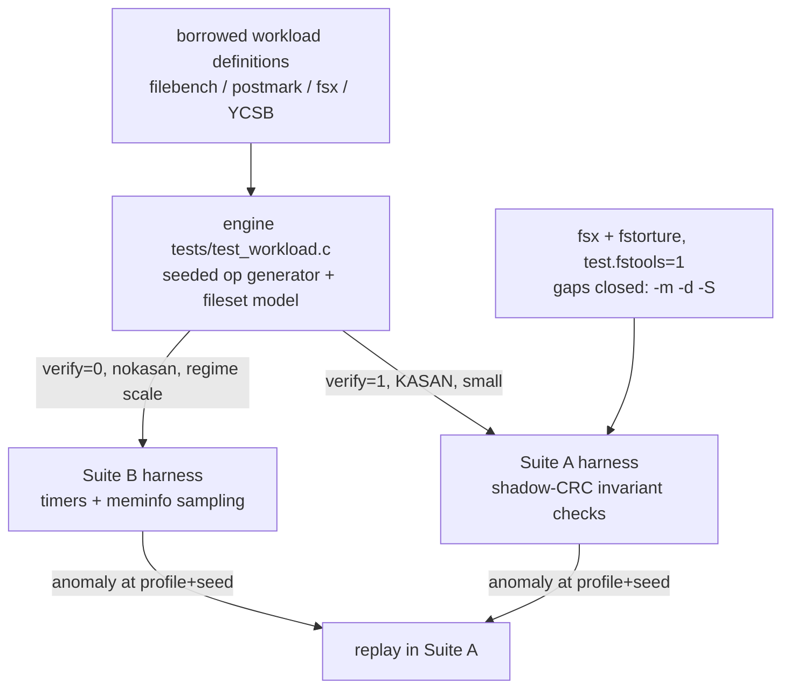

# Workload Test Bed Specification

## Overview

Define the tmpfs-compression test bed as two suites with different contracts:
a **correctness suite** (binary PASS/FAIL, KASAN, every kernel change) and a
**performance suite** (numbers, no thresholds, nokasan, on demand). Both
suites draw from one workload model, and that model is not invented here: it
is assembled from established, citable workload definitions (fsx/fstorture,
filebench personalities, postmark's transaction model, fio's measurement
conventions, SNIA's steady-state criterion, YCSB's hot-set distribution).
The kernel adapts to these workloads; the workloads never adapt to the
kernel.

## Motigation

The bench set so far (mission logs 33-35) measures sequential fill only:
write-new, read-back, ENOSPC. The session-51 geometry sweep itself records
that the fill workload "only shows half the tradeoff" -- it never frees
sparsely, never appends, never overwrites in place, and never produces the
steady-state partially-live file population that decides whether big cells
pin memory. We need a churn-capable workload bed.

Two failure modes must be avoided while building it:

1. **Reinventing workload definitions.** An op mix invented at this desk is
   indefensible: nobody can say whether it resembles real usage. Every mix,
   size distribution, and hot-set rule in this spec comes from a published
   workload definition, cited by name. Our only additions are
   compression-specific *metrics* (no existing wheel measures RAM per
   logical byte of a compressing tmpfs), not workload shapes.
2. **Blurring the two contracts.** A retention number in a perf run is
   information; the same retention number failing to return to baseline
   after mass-delete in a correctness run is a bug. The suites share the
   engine but not the verdict.

The correctness side already has its wheel: the rig runs Apple's fstools
(`fsx` + `fstorture`, `test.fstools=1`) against eager-compressed mounts.
That integration stays; this spec closes its known gaps (mmap, punch,
seed-replay, scale) instead of replacing it.

## Goals

- One seeded, replayable workload engine (`tests/test_workload.c`) with a
  `verify=1` correctness mode and a `verify=0` measurement mode.
- Five borrowed profile personalities (fileserver, webserver, varmail,
  postmark-churn, build-scratch) plus one minority in-place profile, each
  with concrete parameters traced to its published definition.
- Compression-specific metrics defined exactly: RAM-per-logical-byte,
  retention curve with a steady-state criterion, per-op-class throughput
  and latency percentiles.
- fsx/fstorture gaps closed: mmap and punch-hole modes, seed plumbing,
  larger op counts.
- The session-51 open question answered: run the churn profiles across cell
  geometries (`test.fillcell=`) to complete the "it depends on the
  workload" tradeoff table.

## Non-Goals

- **No upstream filebench/fio/postmark binaries.** No package installs, and
  building their autotools sources into the initramfs is disproportionate.
  We reimplement the *subset of their operation model we need* in one C
  file, citing the source definitions. Absolute numbers are never compared
  to published filebench/postmark results (those assume a block device);
  we compare arm-vs-arm and kernel-vs-kernel.
- **No real-tool trace collection.** The borrowed personalities are the
  external definitions; local tracing (dpkg, make, journal) is optional
  future calibration, not a prerequisite.
- **No new kernel features.** This spec only defines measurement. If a
  profile exposes a kernel deficiency, that becomes a follow-on spec.
- **No CI automation.** Runs stay manual via `run_qemu.sh`, as today.

## Design

### Two suites, two contracts

| | Suite A: correctness | Suite B: performance |
|---|---|---|
| kernel | KASAN | nokasan (`sync_kernel.sh nokasan`) |
| scale | small (fits seconds, ~10-50 MB filesets) | regime-sized (small / tmpfs==RAM / overcommit) |
| verdict | PASS/FAIL on invariants | numbers only; no thresholds |
| cadence | every kernel change, alongside the existing suite | on demand / milestones |
| harness | engine with `verify=1` + fsx/fstorture | engine with `verify=0` + metric sampling |
| reproducibility | seed printed on failure, `-S`-style replay | seed recorded in results header |



### The engine (shared layer)

One new test binary, following the rig's existing conventions (standalone C,
params via kernel cmdline, results on stdout).

```c
/* Operation classes. The wheel: filebench flowops + postmark file ops,
 * plus rename-over (filebench renamefile) as the atomic-replace flow. */
enum wl_op {
	WL_CREATE,      /* createfile */
	WL_WRITE_WHOLE, /* writewholefile: rewrite entire file */
	WL_APPEND_RAND, /* appendfilerand: append 1K at random offset */
	WL_READ_WHOLE,  /* readwholefile */
	WL_READ_RAND,   /* readrandomblock: 4K random read */
	WL_RENAME_OVER, /* renamefile: create+write new, rename over old */
	WL_DELETE,      /* deletefile */
	WL_TRUNCATE,    /* ftruncate down (postmark write-shrink) */
	WL_PWRITE,      /* in-place 4K write into existing file (YCSB update) */
	WL_FSYNC,       /* fsyncfile (varmail flowop; near-free on tmpfs, kept
	                   for flow fidelity) */
	WL_STAT,        /* statfile */
	WL_OP_MAX
};

struct wl_profile {
	const char *name;
	const char *upstream;     /* citation, e.g. "filebench fileserver.def" */
	int   threads;            /* default worker count */
	long  nfiles;             /* fileset entries */
	long  mean_size;          /* bytes; distribution per size_dist */
	int   size_dist;          /* WL_DIST_GAMMA | WL_DIST_UNIFORM */
	double gamma_shape;       /* for WL_DIST_GAMMA (filebench cvar-gamma) */
	int   dirwidth;           /* entries per subdirectory */
	int   prealloc_pct;       /* filebench prealloc semantics */
	double prob[WL_OP_MAX];   /* per-thread op selection weights */
	int   zipf_hotset;        /* 0 = uniform; else YCSB zipfian exponent x100 */
	int   runtime_s;          /* steady-state window */
};

struct wl_stats { /* per-op-class; sampled, see Metrics */
	uint64_t ops[WL_OP_MAX];
	uint64_t bytes[WL_OP_MAX];
	double   lat_p50_ns[WL_OP_MAX];
	double   lat_p99_ns[WL_OP_MAX];
};
```

Determinism: one `xorshift64*` PRNG; global seed `S` from
`test.seed=`; thread `i` uses `S*0x9E3779B97F4A7C15 + i`. Every run header
prints `(profile, S, threads, runtime)` so any Suite-B anomaly replays in
Suite A at the same point in the stream. The generator and fileset model are
byte-identical between suites; only the harness around them differs.

Latency sampling: time a sampled subset of ops (`CLOCK_MONOTONIC`, sample
1/64 of ops per class -- fio's sampling convention) to bound both overhead
and result-buffer memory; p50/p99 from a fixed log-scale histogram.

### Suite A: correctness (borrowed wheel: fsx + fstorture + shadow model)

**Existing, unchanged:** `test.fstools=1` runs `fsx -N 2000` (single-file
random op stream with internal data verification) and `fsx -e` (xattr) and
`fstorture` (directory-tree reference-model comparison incl. rename and
hardlink) on eager-compressed mounts. This is the fsx/fstorture wheel;
keep it.

**Gap closures (all in the same fstools boot mode):**

| Gap | Change | Rationale |
|---|---|---|
| mmap path untested | add `fsx -m -N 5000` run | mmap'd writes/faults hit the decompress-on-fault path (`shmem_decompress_folio`) that plain read() never touches |
| punch-hole untested | add `fsx -d -N 5000` run | punch is a distinct free path; if unsupported/expected-fail on compressed tmpfs, record the verdict as such rather than skipping |
| no replay story | plumb `test.fsxseed=<S>` -> `fsx -S <S>` | a failure must be reproducible from the printed seed |
| low op count | raise base runs to `-N 5000` | 2000 ops ends before churn regimes matter at small scale |

**Engine as a correctness generator (`verify=1`):** the same op stream, run
small and fast under KASAN, with a shadow model: a host-side hash table of
`(file, 4K page index) -> CRC32C` updated on every write/append/
rename-over/truncate/pwrite and checked on every read. Invariants, in the
xfstests spirit (PASS/FAIL, nothing else):

1. *Content integrity:* every read page matches its shadow CRC.
2. *Space accounting:* logical bytes charged == sum of live file sizes;
   `ENOSPC` only at the `size=` limit, with the failing op leaving the
   shadow model consistent.
3. *Baseline return:* after the final mass-unlink, `MemFree` returns within
   1% of its pre-run value (leak/pin detector, stated in user-visible
   terms only).
4. *Termination:* no op blocks indefinitely (the existing time-cap
   convention).

### Suite B: performance (borrowed wheels: filebench / postmark / YCSB, measured fio-style)

Profiles. Numbers in the tables follow the cited upstream definitions where
they exist; scale-downs for a 2G-RAM guest are marked. At implementation,
copy the exact probabilities from the upstream workload model files and
record them in the run header -- do not tune them to kernel behavior.

**W1 fileserver** (filebench `fileserver.def`): general-purpose mixed
churn -- the primary rename-over / delete / rewrite profile.

| Parameter | Value |
|---|---|
| threads | 16 |
| fileset | 8000 files (upstream 10000), dirwidth 20, prealloc 80% |
| size dist | gamma, mean 128K, shape 1.5 (filebench cvar-gamma) |
| ops (weights) | create 5, write-whole 5, append-rand 10, read-whole 20, delete 5, stat 5, **rename-over 5** (renamefile flowop, our atomic-replace emphasis), open/close unweighted flow |
| runtime | 60 s steady window |

**W2 webserver** (filebench `webserver.def`): read-mostly with a small
append log; the hot-set/caching profile.

| Parameter | Value |
|---|---|
| threads | 15 |
| fileset | 1000 files, dirwidth 10, prealloc 100% |
| size dist | gamma, mean 16K, shape 1.5 |
| ops (weights) | read-whole 100, append-rand 1 (access log), open/close unweighted |
| access | uniform over fileset; variant **W2z** replaces uniform with YCSB zipfian (exponent 0.99) to separate hot-page-cache behavior from pool behavior |

**W3 varmail** (filebench `varmail.def`): append-heavy spool with fsync
cadence; the append profile the fill bench cannot see.

| Parameter | Value |
|---|---|
| threads | 16 |
| fileset | 1000 files |
| size dist | gamma, mean 16K, shape 1.5 |
| ops (weights) | append-rand 50, create 5, read-whole 10, delete 10, fsync 20 |

**W4 postmark-churn** (postmark, Katcher NetApp TR3022 2001): transaction
model over a fixed pool -- the steady-state retention driver; pool size
constant by construction (creates balance deletes).

| Parameter | Value |
|---|---|
| threads | 1 (postmark is serial; churn, not concurrency, is the question) |
| pool | 5000 files, size uniform 4K..16K (postmark's default range) |
| transactions | 50000, each = 1-2 ops from {create 20, delete 20, read 25, write 20, append 15} |
| runtime | until transaction budget exhausted |

**W5 build-scratch** (the rig's own untar/torture shape, classified as a
profile; no upstream def needed -- `make`-in-tmpfs is the definition):
phases untar (sequential create+write), read-all (compile simulation,
sequential read), `rm -Rf` (bulk recursive unlink). Reuses the existing
untar256 dataset. Phased, not steady-state; reports per-phase numbers and
the post-delete baseline return.

**W6 in-place random** (YCSB update pattern, Cooper et al. 2010): the
minority real pattern (databases, mmap'd files) and the only profile that
drives the decompress-modify-recompress path at rate. Small on purpose --
its real-world share is small.

| Parameter | Value |
|---|---|
| threads | 4 |
| fileset | 64 files x 8 MiB, preallocated |
| ops | 80% 4K in-place pwrite, 20% 4K read; offsets zipfian (exponent 0.99) |
| headline metric | p99 write latency (the asymmetric path) |

### Metrics (exact definitions)

All sampled once per second, off the op path. Symbols: `L(t)` = logical
bytes (engine-known sum of live file sizes); `R(t)` = `MemFree(t0) - MemFree(t)`
with `t0` = empty-mount sample (user-visible RAM cost, arm-agnostic).

| Metric | Definition | Question it answers |
|---|---|---|
| RAM per logical byte | `rho(t) = R(t) / L(t)`, report median over the steady window | does compression deliver its promise under churn, not just under fill |
| Retention ratio | after mass-delete phase: `rho_after / rho_peak` | the geometry tradeoff's missing half: do big cells pin freed space |
| Steady-state criterion | rolling median of `rho` within +/-10% over 3 consecutive 10-s windows (SNIA PTS steady-state method, adapted) | when to stop reporting ramp and start reporting steady numbers |
| Per-op-class throughput | ops/s and MB/s over the steady window | which op pays for churn |
| Latency | p50/p99 per op class from the sampled histogram | tails, esp. W6 pwrite |
| ENOSPC behavior | time and logical-bytes-to-`ENOSPC` when the regime overcommits | survival, comparable to the fill bench's regime table |

Regimes are reused unchanged from mission log 50's rule: every Suite-B run
names its tmpfs-size-to-RAM ratio (small / exact / overcommit).

### Parameterization (rig conventions)

All parameters arrive via the kernel cmdline, like `test.fillcell=` (the
session-51 lesson: the guest never sees host env vars):

```
test.workload=W1            # selects the profile (W1..W6, W2z)
test.seed=1234              # PRNG seed, printed in every header
test.wlthreads=16           # override profile thread count
test.wlruntime=60           # override steady window, seconds
test.wlverify=1             # Suite A mode (shadow CRC); default 0
test.wlfiles=8000           # scale knob for regime fitting
test.fillcell=64K           # existing geometry override; W1/W4 x geometry
                            #   sweeps answer the session-51 open question
test.fsxseed=1234           # fsx -S replay in the fstools boot mode
```

`guest/init.sh` gains a `test.workload=` boot mode following the exact
pattern of `test.fill=`/`test.cellgcbench=`; `scripts/run_qemu.sh` passes
the params through; `scripts/build_tests.sh` picks up `tests/test_workload.c`
automatically from its `tests/*.c` derivation.

## Build Changes

| Target | Change |
|---|---|
| `tests/test_workload.c` | new; auto-derived by `scripts/build_tests.sh` (no build-system edit expected -- verify) |
| `guest/init.sh` | new boot mode `test.workload=`; fstools mode extended with `-m`, `-d`, `-S`, higher `-N` |
| `scripts/run_qemu.sh` | pass-through of the `test.wl*`, `test.workload`, `test.seed`, `test.fsxseed` params |
| kernel source | **no changes** (any kernel change triggered by a profile is a follow-on spec) |

## File Manifest

| File | Action | Purpose |
|---|---|---|
| `specs/05_WORKLOAD_TESTBED.md` | Create | This spec |
| rig `tests/test_workload.c` | Create | The seeded workload engine (profiles W1-W6, verify + measure modes) |
| rig `guest/init.sh` | Modify | `test.workload=` boot mode; fsx gap closures |
| rig `scripts/run_qemu.sh` | Modify | cmdline plumbing for the new params |

## Migration

### Phase 1: engine core + W4 in verify mode (est. half a day)

1. Implement engine skeleton: PRNG, fileset model, op table, shadow-CRC
   verify mode.
2. Implement W4 (postmark-churn) -- smallest profile, exercises every op
   class including rename-over and in-place pwrite.
3. Gate: runs clean under KASAN at small scale on both arms (2 zsmalloc,
   3 cells); all four invariants pass; the full existing suite still green.

### Phase 2: remaining profiles + metrics (est. 1 day)

1. W1, W2/W2z, W3, W5, W6 with upstream probabilities copied and cited.
2. Metric sampling (rho, retention, latency histograms, steady-state
   detection) and the results header format.
3. `init.sh`/`run_qemu.sh` plumbing.
4. Gate: one nokasan numbers run per profile at the small regime on arms
   2 and 3; results committed under `results/`.

### Phase 3: fsx/fstorture gap closures (est. half a day)

1. Add `-m` and `-d` runs, `-N 5000`, `test.fsxseed=` plumbing to the
   fstools boot mode; record punch-hole's verdict (pass or expected-fail).
2. Gate: fstools boot mode green under KASAN on arm 3.

### Phase 4: the geometry x workload matrix (est. half a day)

1. Run W1 and W4 (the churn-heavy pair) across cell geometries 64K / 1M /
   4M via `test.fillcell=` at the exact-fit regime; build the retention
   and throughput table.
2. Gate: the session-51 open question ("the churn/sparse side of the
   tradeoff") has a numbers answer, written up as a mission log.

Each phase is independently committable in the rig repo.

## Risks

| Risk | Likelihood | Impact | Mitigation |
|---|---|---|---|
| Engine bug produces wrong numbers | Med | Med | `verify=1` mode runs the identical stream with CRC checks; cross-check engine ops against fsx behavior on the same mount |
| Metric sampling perturbs the workload | Low | Med | 1-s sampling off the op path; latency sampling 1/64 ops; verify by comparing no-sampler vs sampler runs |
| Profiles don't fit the 2G guest at exact-fit regime | Med | Low | `test.wlfiles=` scale knob; report at fixed occupancy fraction, note the scale factor in the header |
| fsx `-d` unsupported on compressed tmpfs | Med | Low | Expected-fail recorded as a documented verdict; still closes the "untested" gap either way |
| Borrowed probabilities fit block devices, not RAM disks | High | Low | Numbers are compared arm-vs-arm and kernel-vs-kernel only; personality *structure* is what we borrow -- stated in every results header |
| Zipfian table memory at large filesets | Low | Low | CDF-based discrete sampler built once per fileset; filesets here are <=8k entries |

## Open Questions

- Does punch-hole (`fsx -d`) have defined semantics on compressed tmpfs
  today, or is it expected-fail? Phase 3 records the verdict.
- Should W3's fsync flowop be kept (free on tmpfs, costs nothing, keeps
  flow fidelity) or dropped as noise? Decide on the first Phase-2 run.
- W2z's zipfian sampler: simple CDF walk is fine at 1k entries; revisit
  only if a future profile needs large hot-set tables.

## References

- [specs/02_ZTMPFS_TRANSPARENT_COMPRESSION.md] -- the feature under test
- [specs/04_GC_REVERSE_INDEX.md] -- GC cost the churn profiles will drive
- [mission_log/2026-10-13_cell-geometry-sweep.md] -- fill workload's
  half-of-the-tradeoff gap this spec closes
- [mission_log/2026-10-13_dual-kernel-setup-and-tmpfs-equals-ram-bench.md]
  -- the three bench regimes and dual-kernel convention reused here
- filebench 1.5-alpha workload models `fileserver.def`, `webserver.def`,
  `varmail.def` (Sun Microsystems; flowop/fileset model)
- J. Katcher, "PostMark: A New File System Benchmark", NetApp TR3022,
  2001 (transaction model, small-file churn)
- D. Axboe, fio (measurement conventions: ramp time, sampled latency
  percentiles)
- SNIA IOTTA / Performance Testing Specification (steady-state criterion,
  adapted for the retention curve)
- B. Cooper et al., "Benchmarking Cloud Serving Systems with YCSB", 2010
  (zipfian hot-set, update-workload pattern)
- Apple fstools (`fsx`, `fstorture`) -- already integrated in the rig
  (`test.fstools=1`); xfstests lineage for the op-stream-with-verification
  method
